# Test Execution System Design

> **Reference rule:** Whenever this document is consulted, also consult [test-execution-rules.md](test-execution-rules.md) for the current flow, data, template, XML, execution, and reporting governance rules.

## Table of Contents

- [1. Purpose and Scope](#1-purpose-and-scope)
- [2. Concise Architecture Blueprint (Architecture DNA)](#2-concise-architecture-blueprint-architecture-dna)
    - [2.1 Conceptual Hierarchy of Data Layers](#21-conceptual-hierarchy-of-data-layers)
    - [2.2 Traceability Matrix By Functional Areas](#22-traceability-matrix-by-functional-areas)
- [3. Requirements Baseline Reference](#3-requirements-baseline-reference)
    - [3.1 Functional Requirements Summary](#31-functional-requirements-summary)
    - [3.2 Non-Functional Requirements / Architecture Properties](#32-non-functional-requirements--architecture-properties)
- [4. High-Level Architecture Overview](#4-high-level-architecture-overview)
    - [4.0 Product vs Project Ownership Contract](#40-product-vs-project-ownership-contract)
    - [4.1 C1 System Context Diagram](#41-c1-system-context-diagram)
    - [4.2 C2 Container Diagram](#42-c2-container-diagram)
    - [4.3 C3 Component Diagram](#43-c3-component-diagram)
    - [4.4 C4 Code / Implementation View](#44-c4-code--implementation-view)
    - [4.5 Runtime Sequence Diagram](#45-runtime-sequence-diagram)
- [6. High Level ERD](#6-high-level-erd)
- [7. Low Level ERD](#7-low-level-erd)
    - [7.1 Entity-to-File Mapping (Core ERD Entities)](#71-entity-to-file-mapping-core-erd-entities)
- [8. Folder Structure by Ownership](#8-folder-structure-by-ownership)
    - [8.1 Folder Structure for Maintaining Code and Data](#81-folder-structure-for-maintaining-code-and-data)
- [Appendix](#appendix)

## 1. Purpose and Scope

This document defines the system-level design for Test Execution as a product capability.
It is intentionally limited to high-value architecture, ownership, runtime contracts, and entity relationships needed to build and run execution workflows consistently across projects.

<table>
<thead>
<tr>
<th align="left" valign="top">In Scope</th>
<th align="left" valign="top">Out of Scope</th>
</tr>
</thead>
<tbody>
<tr>
<td align="left" valign="top">
<ul>
<li>Test execution architecture and runtime responsibilities.</li>
<li>Product vs project ownership boundaries for execution artifacts.</li>
<li>Traceability alignment from execution inputs to run evidence.</li>
<li>High-level ERD for prep-to-execute entity relationships.</li>
</ul>
</td>
<td align="left" valign="top">
<ul>
<li>Rewriting detailed user stories and acceptance criteria.</li>
<li>Detailed per-test-case scripts or run logs.</li>
<li>Low-level implementation details already captured in component-level design documents.</li>
</ul>
</td>
</tr>
</tbody>
</table>

Ownership baseline for this document:
- Product level: reusable execution capability, runtime contracts, policy semantics, and canonical master data, including shared block flows and `data/product/master-data/payment-method-entity-attribute-mapping.yaml` for cycle payment-type resolution.
- Project level: project/test-case intent, approved workflow content, and run-cycle evidence.

## 2. Concise Architecture Blueprint (Architecture DNA)

This system design is anchored to the embedded traceability matrix below.

Design governance rule:
- The matrix below is the DNA source for architecture-to-data-to-code-to-evidence mapping.
- Any architecture, workflow, reporting, or command change in this document must remain consistent with that matrix.
- If a conflict exists, the matrix definition takes precedence and this document must be updated.

Ownership interpretation rule:
- When this document references matrix entities, ownership is read as Product capability versus Project intent/evidence.
- MASTER_DATA and reusable block catalogs are always Product-level unless explicitly reclassified by architecture governance, including reusable Klarna flows that are part of the shared product baseline.
- Rule governance is layered by level: Product rules define reusable constraints, Project rules define case binding, Cycle rules define batch gating, and Script rules define approved execution behavior.
- The user-facing phase contract is the six functional areas and eleven subphases defined in this document. Subphase 1.1 corresponds to the embedded test-block-association table created by `/prep-test-script`; missing blocks must be surfaced there before workflow generation continues.
- `/prep-test-script` first derives the test-case-backed step-to-block association table for the selected TC by reading `test-cases.json`, evaluating business intent, and anchoring the chain to reusable block flows and reusable blocks within the TC's embedded design artifact when the exact flow is missing.
- For verification steps, `/prep-test-script` must match by verification intent, not by block id alone; `VER-01` is never a default reuse target.
- If the selected TC's verification intent does not exactly match an existing verification block contract, the prep flow must escalate to `MISSING_BLOCK` and draft a new logical verification block rather than repurposing `OMSKlarnaReconciliationHarness` by id.
- `/prep-test-script` first performs an internal pseudo-block-table analysis for the selected TC to derive required blocks, block flow, template availability, and any missing-block or missing-flow escalation before workflow generation continues.

### 2.1 Conceptual Hierarchy of Data Layers

The testing product is organised into five levels of abstraction, from reusable framework to runtime evidence.

| Level | Name | One-liner | Maps to |
|---|---|---|---|
| 1 | **Testing Product** | Reusable execution engine, block catalog, input-block-template inheritance infrastructure, and data model, including canonical provider flows that are shared across projects such as Klarna payment flows. | `MASTER_DATA`, `APPLICATION`, `APP_ENV`, `TEST_BLOCK`, `TEST_BLOCK_FLOW`, `BLOCK_TEMPLATE`, `TEST_SEED_CATALOG`, `INPUT_PAYLOAD` |
| 2 | **Test Project** | Project-specific test intent, configuration, overlays, and project-level rules for case binding. | `PROJECT`, `TEST_CASE`, `TEST_CASE_STEP`, `TEST_CASE_EXECUTION_DATA` |
| 3 | **Test Cycle** | Optional batch validation/materialization over test-case-owned execution data, plus cycle grouping, verdict, evidence, and cycle-level rules. | `TEST_CYCLE`, `TEST_CASE_EXECUTION`, `TEST_CYCLE_CONFIG`, `CYCLE_PREPARED_DATA` |
| 4 | **Test Script Design** | Approved executable workflow and TC-specific prepared input definitions for one scenario, including the test-case-data binding, input payload previews for every workflow block in `test-script-design.md`, the materialized INT-09 XML file, and script-level preparation rules. | `WORKFLOW`, `WORKFLOW_STEP`, `WORKFLOW_STEP_CONFIG`, `ORDER_XML_DERIVATION`, `ORDER_XML_CHILD` |
| 5 | **Test Script Execution** | Runtime execution plus structured evidence, the materialized child XML consumed by execution, and script-level runtime rules for gates, retries, and reporting. | `PREPARED_EXECUTION_DATA`, `ORDER_XML_CHILD`, `RUN_METADATA`, `BLOCK_RESULT`, `RUN_LOG_SUMMARY`, `RUN_LOG_*`, `LATEST_STATUS`, `RUN_HISTORY` |

## Phase-Based Test Assistance Model

This model defines six functional-area phases and eleven subphases for functional test preparation, execution, reporting, improvement, and batch planning. Each subphase identifies the expected assistance level, inputs, activities, output, human gate, and command handoff.

| Functional Area | Phase | Sub Phase | Phase Name | Command | Assistance | Input | Key Activities | Output | Human Gate |
|---|---:|---:|---|---|---|---|---|---|---|
| Setup | 0 | 0.1 | WorkSpace Setup | `/setup-workspace` | HIGH | Repository<br>Workspace | Prepare workspace | Ready Workspace | — |
| Setup | 0 | 0.2 | Project Setup | `/setup-testing-project` | HIGH | Jira Ticket<br>Test Case | Review -> Draft -> Configure | Project Setup | Approve / Reject |
| Setup | 0 | 0.3 | Cycle Setup | `/prep-test-cycle` | HIGH | Project<br>Test Case<br>Environment<br>User Overrides | Select -> Resolve -> Validate -> Draft | Prepared Cycle Data | Approve / Correct |
| Script Design | 1 | 1.1 | Test Case -> Block Flow Mapping/Discovery | `/prep-test-script` | HIGH | Test case<br>Cycle/business context<br>Regional Block Flow Catalog | Understand intent -> Resolve region -> Identify relevant regional reference | Reference ID/version or BLOCK_FLOW_MISSING; no association table or candidate comparison | None; continue directly to 1.2 |
| Script Design | 1 | 1.2 | Step -> Block Mapping | `/prep-test-script`<br>`/create-block` | HIGH | Regional reference or missing-flow result<br>TC steps<br>Block Catalog | Map steps to blocks -> Identify missing blocks -> Resolve gaps -> Validate coverage -> Show complete association and item tables | Step-to-Block Mapping + Gap Review | Approve / Correct Mapping after displaying tables |
| Script Design | 1 | 1.3 | Data & XML Preparation | `/prep-test-script` | HIGH | Cycle data<br>Approved create-order template | Prepare INT-09 create-order data -> Apply approved overrides -> Bind create-order XML -> Validate structure and lineage | Prepared INT-09 XML + lineage | Approve / Correct Data |
| Script Design | 1 | 1.4 | Workflow Assembly & Freeze | `/prep-test-script` | LOW -> MEDIUM | Regional reference context and approved 1.2-1.3 outputs | Show complete workflow -> Approve and freeze block/mode sequence -> Prepare complete native inputs for §5.1 -> Validate rules and coverage -> Show final draft | Frozen workflow + complete §5.1 inputs (XML, SQL, or documented native format) | Workflow approval -> Final draft/save approval |
| Execute | 2 | 2.1 | Approved Workflow Execution | `/execute-test` | LOW -> MEDIUM | Frozen approved workflow<br>Cycle data<br>Cycle Environment | Load workflow -> Execute blocks -> Capture state/logs/evidence -> Determine status | Results + Runtime Evidence | Proceed / Stop |
| Reporting | 3 | 3.1 | Reporting & Evidence | `/execute-test` | NONE / Manual | Results and logs<br>Evidence<br>Assertions | Consolidate results -> Classify failures -> Map results to steps/blocks -> Generate report | Run Report + Evidence Summary | Review / Accept |
| Improvement | 4 | 4.1 | Product Improvement Loop | `/create-block-flow` | LOW | Result reusable patterns | Identify recurring gaps -> Propose changes -> Review -> Apply approved improvements | Improvement Proposal + Product Changes | Approve / Modify / Reject |
| Batch | 5 | 5.1 | Batch Planning & Execution | `/prep-test-cycle`<br>`/execute-test` | LOW | Approved scripts | Group approved scripts -> Check dependencies -> Plan execution order -> Prepare queue | Batch Plan + Execution Queue | Approve / Review |

Setup and Script Design subphases proceed in order with the gates shown above. Phase 1.1 is informational only and continues directly to 1.2. At every approval gate, display the complete relevant draft in chat before asking; progress announcements and file links do not replace the draft. Execute consumes only a frozen approved workflow. Reporting and Improvement consume runtime results, while Batch groups approved scripts; none may silently rewrite upstream approved artifacts.

Slash command map:

| Slash Command | Main Use | Phase / Subphase |
|---|---|---|
| `/setup` (phase-model name `/setup-workspace`) | Configures and validates the local VS Code Java workspace. | Setup: WorkSpace Setup (0.1) |
| `/setup-testing-project` | Drafts the project config and test-case manifest from Jira and test-case input, then writes them after review. | Setup: Project Setup (0.2) |
| `/prep-test-cycle` (alias `/prep-cycle-execution`) | Resolves selected cases, environment, overrides, and lineage into an approved cycle handoff; also prepares batch context. | Setup: Cycle Setup (0.3); Batch: Batch Planning & Execution (5.1) |
| `/prep-test-script` | Derives the TC-embedded block-association table, prepares only the INT-09 create-order XML in Phase 1.3, then assembles the workflow and prepares complete native-format inputs for every block after Phase 1.4 workflow approval. | Script Design: Test Case -> Block Flow Mapping/Discovery (1.1); Step -> Block Mapping (1.2); Data & XML Preparation (1.3); Workflow Assembly & Freeze (1.4) |
| `/create-block-flow` | Drafts a missing flow or reviewed catalog improvement; persists changes only after approval. | Script Design: Test Case -> Block Flow Mapping/Discovery (1.1); Improvement: Product Improvement Loop (4.1) |
| `/create-block` | Drafts or updates a missing reusable block contract, pending review and approval. | Script Design: Step -> Block Mapping (1.2); Improvement: Product Improvement Loop (4.1) |
| `/execute-test` | Executes the approved workflow and publishes run results, logs, and evidence; supports batch runs. | Execute: Approved Workflow Execution (2.1); Reporting: Reporting & Evidence (3.1); Batch: Batch Planning & Execution (5.1) |
| `/create_defect` | Previews a Jira defect from failed-run context and evidence, then creates it with attachments after approval. | Reporting: Reporting & Evidence (3.1) |
| `/zephyr-update` | Updates Zephyr test execution statuses from reviewed run outcomes, manual selections, or a spreadsheet. | Reporting: Reporting & Evidence (3.1) |

Hierarchy relationships:
- A **Testing Product** is instantiated as one or more **Test Projects**.
- A **Test Project** owns a catalog of **Test Cases**.
- Each **Test Case** has exactly one **Test Script Design**: the approved, ordered workflow of blocks that makes the scenario executable.
- A **Test Cycle** selects a subset of **Test Cases** (and their **Test Script Designs**) from a **Test Project** and executes them as a batch against a target environment and build.
- Each **Test Script Execution** produces evidence (run logs, assertions, timings) that rolls up to the **Test Cycle** verdict.
- Rule governance is layered by the same hierarchy: product rules define reusable constraints, project rules define case binding, cycle rules define batch gating, and script rules define approved execution behavior.

### 2.2 Traceability Matrix By Functional Areas

The matrix follows the phase-model hierarchy in the supplied traceability matrix. Phase IDs are included in the Phase / Sub-Functional Area values.

| Functional Area | Phase / Sub-Functional Area | Slash Commands | Capability / Responsibility | Application | Architecture Component (C4/Runtime) | Code Files | Information | ERD Artifacts | ERD Relationship Anchor | Data Files |
|---|---|---|---|---|---|---|---|---|---|---|
| Setup | 0.1 Workspace Setup | /setup-workspace (phase model); current prompt alias /setup | Prepare local workspace by validating workspace and required tooling configuration. | Developer Workspace | Developer Environment Setup; Workspace Bootstrap | • `.github/prompts/setup.prompt.md`<br>• `.github/skills/setup-vscode-java-project-skills.md` | Input: repository root and toolchain settings. Contract: workspace setup guide and environment prerequisites.<br>Output: ready workspace. | — | Repository -> workspace configuration | • `.vscode/settings.json`<br>• `.vscode/extensions.json` |
| Setup | 0.2 Project Setup | /setup-testing-project | Create the project config, test-case manifest, and script root from approved Jira and test-case inputs. | Project Setup Application | Project Onboarding; Project Scaffold Builder | • `.github/prompts/setup-testing-project.prompt.md` | Input: Jira key and test-case definitions. Contract: project scaffold and manifest require approval before writes.<br>Output: project scaffold and reviewed manifest. | PROJECT, TEST_CASE | Jira ticket -> PROJECT -> TEST_CASE | • `.github/specs/<project>/verification/functional-testing/config/project-functional-testing.yaml`<br>• `.github/specs/<project>/verification/functional-testing/test-cases/test-cases.json` |
| Setup | 0.3 Cycle Setup | /prep-test-cycle | Resolve selected cases, environment, overrides, values, and lineage into an approval-ready cycle handoff. | Cycle Preparation Application | Cycle Context Manager + Cycle Preparer; Cycle Resolver, Data Preparer, Cycle Validator | • `.github/prompts/prep_test_cycle.prompt.md`<br>• `src/product/config/loader.py`<br>• `src/cycle/prep/cycle_preparer.py`<br>• `src/cycle/validation/cycle_validator.py` | Input: selected cases, environment, overrides, payment-method master data, and per-case values. Contract: resolve payment type from the manifest, load its YAML mapping into cycle execution data, record lineage, and require approval for the project-config update.<br>Output: prepared cycle data and lineage. | TEST_CYCLE, TEST_CYCLE_CONFIG, TEST_CASE_EXECUTION_DATA, CYCLE_PREPARED_DATA, DATA_LINEAGE | PROJECT + TEST_CASE + environment/overrides -> TEST_CYCLE_CONFIG -> CYCLE_PREPARED_DATA | • `.github/specs/<project>/verification/functional-testing/config/project-functional-testing.yaml`<br>• `.github/specs/<project>/verification/functional-testing/cycle-execution/cycle-execution-<cycle-id>.json`<br>• `data/product/master-data/payment-method-entity-attribute-mapping.yaml`<br>• `data/cycle/rules/cycle-rules.yaml` |
| Script Design | 1.1 Test Case -> Block Flow Mapping/Discovery | /prep-test-script; /create-block-flow (missing-flow review) | Analyze test intent, resolve the matching configured flow, and surface missing-flow or block gaps. | Test Design Application | Flow Resolver + Script Design Builder; Flow Resolver, Association Analyzer | • `src/product/routing/resolver.py`<br>• `src/script/design/script_builder.py`<br>• `.github/prompts/create_block_flow.prompt.md` | Input: test intent, steps, and business context. Contract: resolve the configured flow and draft the block association; when the flow is missing, propose a flow for approval before catalog changes.<br>Output: flow mapping and draft association table, or a reviewed flow proposal. | TEST_CASE, TEST_CASE_STEP, TEST_BLOCK_FLOW, TEST_BLOCK | TEST_CASE -> flow map -> TEST_BLOCK_FLOW -> TEST_BLOCK | • `.github/specs/<project>/verification/functional-testing/test-cases/test-cases.json`<br>• `data/product/master-data/order-type-block-flow-map.yaml`<br>• `data/product/master-data/block-flow-catalog.yaml`<br>• `.github/specs/<project>/verification/functional-testing/test-scripts/<TC-ID>/test-script-design.md` |
| Script Design | 1.2 Step -> Block Mapping | /prep-test-script; /create-block | Map test steps to ordered reusable blocks; validate coverage and identify missing-block gaps. | Test Design Application | Design Builder + Design Validator; Step Mapper, Block Registry, Validator | • `src/script/design/script_builder.py`<br>• `src/script/design/script_validator.py`<br>• `src/script/blocks/registry.py` | Input: approved flow, test steps, and block contracts. Contract: map every step, validate coverage, and identify missing blocks. Output: step mapping and gap review. | TEST_CASE_STEP, TEST_BLOCK, WORKFLOW_STEP | TEST_CASE_STEP -> TEST_BLOCK -> WORKFLOW_STEP | • `.github/specs/<project>/verification/functional-testing/test-scripts/<TC-ID>/test-script-design.md`<br>• `.github/specs/<project>/verification/functional-testing/test-scripts/<TC-ID>/test-script-workflow.yaml`<br>• `data/product/master-data/test-block-catalog.yaml`<br>• `data/product/master-data/block-flow-catalog.yaml` |
| Script Design | 1.3 Test Data and XML Preparation | /prep-test-script | Prepare the INT-09 create-order XML from approved cycle values, preserve its template structure, and record lineage. | Test Design Application | Cycle Preparer + XML Deriver; Data Binder, Template Binder, XML Deriver | • `src/cycle/prep/cycle_preparer.py`<br>• `src/script/design/xml_deriver.py`<br>• `src/script/design/script_builder.py` | Input: approved cycle values and resolved INT-09 create-order template. Contract: bind only authorized values, preserve XML structure, and record lineage. Output: prepared INT-09 create-order XML with lineage. | TEST_CASE_EXECUTION_DATA, CYCLE_PREPARED_DATA, ORDER_XML_TEMPLATE, ORDER_XML_DERIVATION, ORDER_XML_CHILD, DATA_LINEAGE | Cycle/test data + template -> ORDER_XML_DERIVATION -> ORDER_XML_CHILD + DATA_LINEAGE | • `.github/specs/<project>/verification/functional-testing/cycle-execution/cycle-execution-<cycle-id>.json`<br>• `data/product/payloads/templates/block-templates/input-block-template/`<br>• `.github/specs/<project>/verification/functional-testing/test-scripts/<TC-ID>/inputs/int09-order-create.xml` |
| Script Design | 1.4 Workflow Assembly and Freeze | /prep-test-script | Approve and freeze the ordered workflow, then prepare and validate complete native-format inputs for every workflow block/mode. | Test Design Application | Script Builder + Script Validator; Workflow Assembler, Input Binder, Validator, Artifact Lifecycle | • `src/script/design/script_builder.py`<br>• `src/script/design/script_validator.py`<br>• `src/script/design/artifact_lifecycle.py` | Input: approved flow, mappings, prepared INT-09 XML, and rules. Contract: freeze the approved workflow sequence, bind workflow parameters, and put one complete input preview per block/mode in §5.1 using XML, SQL, or another documented native format. Output: validated frozen workflow and complete §5.1 input previews. | WORKFLOW, WORKFLOW_STEP, WORKFLOW_STEP_CONFIG, INPUT_PAYLOAD | Approved mapping/data -> WORKFLOW -> WORKFLOW_STEP -> WORKFLOW_STEP_CONFIG + native input previews | • `.github/specs/<project>/verification/functional-testing/test-scripts/<TC-ID>/test-script-workflow.yaml`<br>• `.github/specs/<project>/verification/functional-testing/test-scripts/<TC-ID>/test-script-design.md`<br>• `data/script/rules/script-rules.yaml`<br>• `data/cycle/rules/cycle-rules.yaml` |
| Execute | 2.1 Approved Workflow Execution | /execute-test | Execute only the approved workflow and prepared inputs; record deterministic step results and runtime evidence. | Execution Application | Execution Engine + Block Runtime; Run Controller, Step Executor, Block Runtime | • `src/script/execution/workflow_runner.py`<br>• `src/script/execution/step_executor.py`<br>• `src/script/execute_workflow.py` | Input: frozen workflow, cycle data, target environment, and runtime state. Contract: execute the approved workflow and record block results. Output: run status and runtime evidence. | TEST_CYCLE, TEST_CASE_EXECUTION, RUN_METADATA, BLOCK_RESULT, ERROR_CLASS | WORKFLOW + CYCLE_PREPARED_DATA -> RUN_METADATA -> BLOCK_RESULT | • `.github/specs/<project>/verification/functional-testing/test-scripts/<TC-ID>/test-script-workflow.yaml`<br>• `.github/specs/<project>/verification/functional-testing/test-scripts/<TC-ID>/inputs/int09-order-create.xml`<br>• `.github/specs/<project>/verification/functional-testing/test-scripts/<TC-ID>/_run-logs/` |
| Reporting | 3.1 Reporting and Evidence | /execute-test; /create_defect (reviewed, optional); /zephyr-update (reviewed, optional) | Classify outcomes and consolidate results, assertions, timings, and history into published evidence; optionally create a reviewed Jira defect or update Zephyr status. | Reporting Application | Result Publisher + Evidence Projector; Result Aggregator, Assertion Reporter, Run Log Index; external Jira/Zephyr sync | • `src/script/evidence/result_publisher.py`<br>• `src/script/evidence/assertion_reporter.py`<br>• `src/script/evidence/run_log_index.py`<br>• `.github/prompts/create_defect.prompt.md`<br>• `.github/prompts/zephyr-update.prompt.md`<br>• `scripts/zephyr-bulk-update.ps1` | Input: step results, logs, assertions, and timings. Contract: classify outcomes and publish report, index, and status projections; require review before optional external Jira or Zephyr updates.<br>Output: run report and evidence summary, plus Jira defect or Zephyr status when approved. | RUN_METADATA, RUN_LOG_SUMMARY, RUN_LOG_PHASE_TIMING, RUN_LOG_ASSERTION, RUN_LOG_RETRY, RUN_LOG_INDEX_ROW, LATEST_STATUS, RUN_HISTORY | RUN_METADATA -> RUN_LOG_SUMMARY -> evidence/index/status/history; approved evidence -> optional external sync | • `.github/specs/<project>/verification/functional-testing/test-scripts/<TC-ID>/_run-logs/`<br>• `.github/specs/<project>/verification/functional-testing/test-scripts/index.md` |
| Improvement | 4.1 Product Improvement Loop | /create-block-flow | Turn recurring result gaps into reviewed flow or block changes; persist catalog updates only after approval. | Product Governance Application | Product Governance + Catalog Maintenance; Improvement Review, Flow Catalog Maintainer | • `.github/prompts/create_block_flow.prompt.md` | Input: recurring failures, reusable patterns, and affected catalog entries. Contract: draft flow/block improvements and apply catalog changes only after approval. Output: improvement proposal and approved product changes. | RUN_LOG_SUMMARY, TEST_BLOCK_FLOW, TEST_BLOCK | Run evidence -> reviewed proposal -> approved catalog/map update | • `data/product/master-data/block-flow-catalog.yaml`<br>• `data/product/master-data/order-type-block-flow-map.yaml` |
| Batch | 5.1 Batch Planning and Execution | /prep-test-cycle; /execute-test | Group approved scripts, check dependencies, and prepare or execute the queue with shared cycle context. | Cycle and Execution Applications | Cycle Context Manager + Execution Engine; Batch Selector, Queue Planner, Run Controller | • `src/cycle/prep/cycle_preparer.py`<br>• `src/script/execute_workflow.py` | Input: approved scripts, dependencies, and cycle context. Contract: select approved cases and preserve cycle context through batch execution. Output: batch plan, execution queue, and run evidence. | TEST_CYCLE, TEST_CASE_EXECUTION, WORKFLOW, RUN_METADATA, BLOCK_RESULT | Approved workflows + cycle context -> TEST_CASE_EXECUTION -> run evidence | • `.github/specs/<project>/verification/functional-testing/test-cases/test-cases.json`<br>• `.github/specs/<project>/verification/functional-testing/cycle-execution/cycle-execution-<cycle-id>.json`<br>• `.github/specs/<project>/verification/functional-testing/test-scripts/<TC-ID>/test-script-workflow.yaml`<br>• `.github/specs/<project>/verification/functional-testing/test-scripts/<TC-ID>/_run-logs/` |

## 3. Requirements Baseline Reference

This document summarizes the execution requirements baseline rather than restating the full story set.
For the detailed source of truth, see [.github/specs/functional-testing-product/01-intent/requirements.md](../DMI-551-dom-klarna-bnpl/01-intent/requirements.md).

### 3.1 Functional Requirements Summary

This summary captures the functional capabilities required for Test Execution.

| Functional Area | Summary | Primary Design Impact |
|---|---|---|
| Local Machine Setup | A user can bootstrap a local environment with the required toolchain, Playwright browsers, Python deps, and client certificate. | Establishes repeatable local readiness and one-time setup behavior. |
| Environment Setup | A user can select and prepare a target environment, application, brand, order type, fulfillment type, and payment type before execution. | Drives environment provisioning, credentials, and pre-run validation. |
| Reusable Test Blocks | Test actions are defined as reusable, parameterised blocks spanning OMS, Hybris, payment, database, API, ESB/SAP, CARS, and channel interactions. | Defines the L1 reusable execution building blocks. |
| Workflow Composition | Reusable blocks are orchestrated into ordered workflows with explicit gates, branches, waits, and retries. | Defines the L4 executable workflow contract. |
| Test Execution | The workflow executes deterministically against the prepared environment, enforces sequencing and timeouts, and produces a clear verdict. | Defines the runtime execution engine and control flow. |
| Result Capture & Sync | Each run produces traceable evidence, persisted logs, and synchronization to Zephyr and JIRA. | Defines reporting, evidence retention, and external sync hooks. |
| Configuration Portability | The same execution assets must run in a new project by configuration only, without code changes. | Reinforces environment-agnostic design and externalized configuration. |

### 3.2 Non-Functional Requirements / Architecture Properties

These properties shape the design and must stay visible as first-class requirements:

| Property | Meaning |
|---|---|
| Separation of concerns | Product runtime remains independent of project workflow content, which is supplied as approved project input. |
| Configuration over code | Workflow behavior is driven by YAML, layered configuration, and policy models rather than hardcoded logic. |
| Stateless execution | Each run resolves its own runtime context instead of relying on previous executions. |
| Traceability | Every execution step produces evidence across metadata, block results, assertions, lineage, and run history. |
| Reusability | Product capabilities are reusable across multiple projects; project-specific behavior stays in project-owned assets. |
| Ownership clarity | Product owns runtime engine, contracts, and shared catalogs; Project owns scenario definitions, workflow selections, and evidence. |
| Controlled integration boundaries | OMS, payment provider, Jira, and Zephyr interactions stay behind explicit adapters and sync boundaries. |
| Security and data discipline | Sensitive data is minimized in logs and artifacts, with least-privilege access and environment-aware controls. |

## 4. High-Level Architecture Overview

The execution system uses a layered model where project-owned test intent is executed by product-owned runtime components.

Architecture layers:
1. Test Intent Layer: test-cases.json and per-TC workflow configuration.
2. Flow Resolution Layer: Block Flow routing by scenario-aware orderType + functionality and version policy.
3. Orchestration Layer: execution engine, policies, shared state, and registry dispatch.
4. Integration Layer: OMS, payment, verification, session lifecycle, and result publishing.
5. Evidence Layer: run metadata, step outcomes, assertion records, and run-log projections.

Core ownership split:
- Product-owned: execution engine, runtime contracts, reusable block implementations, policy model, and master data/catalog assets.
- Project-owned: cycle definitions, approved workflow YAML, src/cycle/test-case evidence, and operational sync outcomes.
- Rule-owned: product, project, cycle, and script rule sets are enforced at the matching level rather than being duplicated across runtime layers.
- Internal prep analysis is owned by the preparation layer: the pseudo-block table is derived from test-case steps and flow catalogs, then used to gate block-flow and block-gap review before workflow generation resumes.

### 4.0 Five-Level Responsibility Contract

This section explains how the five levels map onto the runtime architecture and where each level contributes.

Phase linkage to the assistance concept:
- `/prep-test-script` subphase 1.1 derives the embedded test-block-association table and surfaces missing blocks for review before workflow generation continues.

Responsibility rules:
1. L1 provides reusable runtime capability, catalogs, templates, and policies.
2. L2 provides scenario intent, project configuration, overlays, and project-level rules for case binding.
3. L3 provides cycle selection, environment binding, run grouping, and cycle-level rules for batch gating.
4. L4 provides the approved executable workflow definition and script-level preparation rules.
5. L5 provides runtime evidence, lineage, reporting artifacts, and script-level runtime rules for gates and retries.

Guardrails:
- L1 logic must remain reusable and not hardcode scenario-specific values.
- L2 and L3 inputs should stay declarative and approval-driven.
- L3 cycle rules govern batch handoff readiness before script preparation continues.
- L4 remains the executable contract for step order and block selection, with script rules enforcing validation and runtime gates.
- L5 stays evidence-oriented and must not become a source of design-time truth.

### 4.1 C1 System Context Diagram

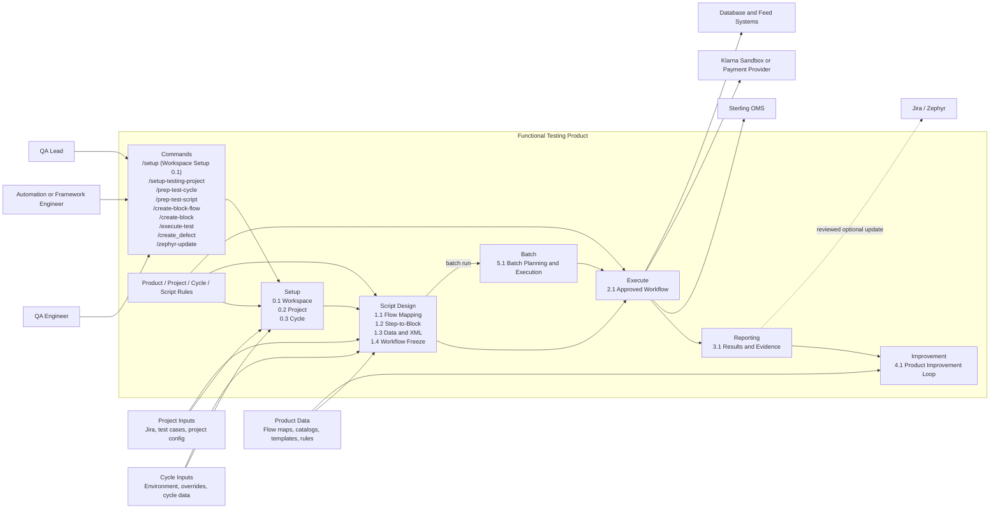

### 4.2 C2 Container Diagram

```mermaid
flowchart LR
    subgraph SETUP["Setup (Pre-Run)"]
        C01["Workspace Setup\n0.1"]
        C02["Project Setup\n0.2"]
        C03["Cycle Setup\n0.3"]
    end

    subgraph DESIGN["Script Design"]
        C11["Flow Mapping / Discovery\n1.1"]
        C12["Step-to-Block Mapping\n1.2"]
        C13["Data and XML Preparation\n1.3"]
        C14["Workflow Assembly and Freeze\n1.4"]
    end

    subgraph EXECUTION["Execution and Reporting"]
        C21["Approved Workflow Execution\n2.1"]
        C31["Reporting and Evidence\n3.1"]
    end

    subgraph IMPROVEMENT["Post-Run Improvement"]
        C41["Product Improvement Loop\n4.1"]
    end

    C51["Batch Planning and Execution\n5.1"]

    C01 --> C02 --> C03 --> C11 --> C12 --> C13 --> C14 -->|single run| C21 --> C31 --> C41
    C14 -->|batch run| C51 --> C21

    classDef setup fill:#E8F1FF,stroke:#2563EB,stroke-width:2px,color:#0F172A;
    classDef design fill:#ECFDF5,stroke:#059669,stroke-width:2px,color:#0F172A;
    classDef execution fill:#FDF2E9,stroke:#EA5800,stroke-width:2px,color:#0F172A;
    classDef postrun fill:#F3E8FF,stroke:#7C3AED,stroke-width:2px,color:#0F172A;
    classDef batch fill:#F1F5F9,stroke:#475569,stroke-width:2px,color:#0F172A;
    class C01,C02,C03 setup;
    class C11,C12,C13,C14 design;
    class C21,C31 execution;
    class C41 postrun;
    class C51 batch;
```

Container-to-component mapping:

| C2 Container | C3 Component |
|---|---|
| Workspace Setup (0.1) | Workspace Bootstrap |
| Project Setup (0.2) | Project Onboarding + Project Scaffold Builder |
| Cycle Setup (0.3) | Config Loader + Cycle Preparer + Cycle Validator + Cycle Rule Resolver |
| Flow Mapping / Discovery (1.1) | Flow Resolver + Script Builder + Association Analyzer |
| Step-to-Block Mapping (1.2) | Script Builder + Block Registry + Script Validator |
| Data and XML Preparation (1.3) | Cycle Preparer + XML Deriver + Template Binder |
| Workflow Assembly and Freeze (1.4) | Script Builder + Script Validator + Artifact Lifecycle |
| Approved Workflow Execution (2.1) | Workflow Runner + Step Executor + Block Runtime |
| Reporting and Evidence (3.1) | Result Publisher + Assertion Reporter + Run Log Index |
| Product Improvement Loop (4.1) | Improvement Review + Flow Catalog Maintainer |
| Batch Planning and Execution (5.1) | Batch Selector + Queue Planner + Run Controller |

### 4.3 C3 Component Diagram

This view shows the end-to-end lifecycle grouped by functional area, with the main handoffs in sequence. Batch planning is an optional path from approved script design into execution. The phase model defines Execution as 2.1; actions inside that group are execution activities, not additional phase IDs.

```mermaid
flowchart LR
    subgraph SETUP["Setup (0.1-0.3)"]
        direction LR
        WORKSPACE["Workspace readiness<br/>0.1"]
        PROJECT_SETUP["Configure project and test cases<br/>0.2"]
        CYCLE_PREP["Resolve environment and overrides<br/>Prepare cycle data and lineage<br/>0.3"]
    end

    subgraph DESIGN["Script Design (1.1-1.4)"]
        direction LR
        FLOW_RESOLVE["Discover intent and matching flow<br/>1.1"]
        BLOCK_MAP["Map test steps to blocks<br/>1.2"]
        XML_PREP["Bind approved data and prepare block inputs<br/>1.3"]
        WORKFLOW["Validate and freeze workflow<br/>Workflow + input XML<br/>1.4"]
    end

    subgraph EXECUTION["Execution (2.1)"]
        direction LR
        RUNNER["Load approved workflow and inputs"]
        BLOCKS["Execute workflow blocks in order"]
        RESULTS["Determine status and capture runtime evidence"]
    end

    subgraph REPORTING["Reporting (3.1)"]
        direction LR
        CLASSIFY["Classify outcomes and assertions"]
        PUBLISH["Publish report, evidence and run history"]
    end

    subgraph IMPROVEMENT["Improvement (4.1)"]
        direction LR
        REVIEW["Review recurring gaps and patterns"]
        UPDATE["Approve reusable flow or block updates"]
    end

    QUEUE["Batch planning and queue (5.1)<br/>Approved workflows + cycle context"]
    TRACK["Optional reviewed Jira / Zephyr update"]

    WORKSPACE --> PROJECT_SETUP --> CYCLE_PREP --> FLOW_RESOLVE --> BLOCK_MAP --> XML_PREP --> WORKFLOW
    WORKFLOW -->|single case| RUNNER
    WORKFLOW -->|batch| QUEUE --> RUNNER
    RUNNER --> BLOCKS --> RESULTS --> CLASSIFY --> PUBLISH --> REVIEW --> UPDATE
    PUBLISH -.-> TRACK

    classDef setup fill:#E6FFFB,stroke:#0F766E,stroke-width:1.5px,color:#0F172A;
    classDef design fill:#F0F7FF,stroke:#3B82F6,stroke-width:1.5px,color:#0F172A;
    classDef runtime fill:#FDF2E9,stroke:#EA5800,stroke-width:1.5px,color:#0F172A;
    classDef reporting fill:#E8F1FF,stroke:#2563EB,stroke-width:1.5px,color:#0F172A;
    classDef improvement fill:#F3E8FF,stroke:#7C3AED,stroke-width:1.5px,color:#0F172A;
    classDef batch fill:#F1F5F9,stroke:#475569,stroke-width:1.5px,color:#0F172A;
    classDef external fill:#FFF7ED,stroke:#C2410C,stroke-width:1.5px,color:#0F172A;
    class WORKSPACE,PROJECT_SETUP,CYCLE_PREP setup;
    class FLOW_RESOLVE,BLOCK_MAP,XML_PREP,WORKFLOW design;
    class RUNNER,BLOCKS,RESULTS runtime;
    class CLASSIFY,PUBLISH reporting;
    class REVIEW,UPDATE improvement;
    class QUEUE batch;
    class TRACK external;
```

C3 modular component organization summary:

| Product Module | Primary Components | Responsibility | Level | Phase |
|---|---|---|---|---|
| prompts/ | Workspace Bootstrap, Project Onboarding, Project Scaffold Builder | Configure the workspace and create the project test scaffold from approved Jira and test-case inputs | Product setup surface | Setup 0.1-0.2 |
| src/product/config/ | Config Loader, Cycle Context Resolver, Policy Resolver | Resolve environment, cycle properties, workflow layers, and rule bundle context into executable context | L1 + L3 | Setup 0.3; Script Design 1.3 |
| src/product/routing/ | Flow Map Resolver, Flow Catalog Resolver, Router | Resolve orderType + functionality to flow ID; enforce version constraints; unified flow selection | L1 | Script Design 1.1 |
| src/cycle/ | Cycle Preparer, Data Lineage Recorder, Execution Plan Builder, Cycle Validator | Resolve cycle data offline, record lineage, and validate cycle readiness and handoff | L1 + L3 | Setup 0.3; Script Design 1.3; Batch 5.1 |
| src/script/design/ | Script Builder, Pseudo-Block Analyzer, Flow Gap Resolver, XML Deriver, Script Validator | Map flows and steps, prepare data/XML, and assemble and validate the frozen workflow | L1 + L4 | Script Design 1.1-1.4 |
| src/script/execution/ | Workflow Runner, Step Executor, Retry Policy Engine, Context Manager | Execute the approved workflow; apply retries and gates; manage runtime state | L1 + L4 + L5 | Execute 2.1; Batch 5.1 |
| src/script/evidence/ | Result Publisher, Assertion Reporter, Run Log Index Manager | Publish run results, assertions, index, and evidence projections | L1 + L5 | Reporting 3.1 |
| Product catalogs | Improvement Review, Flow Catalog Maintainer | Apply approved reusable flow or block catalog improvements | L1 | Improvement 4.1 |

### 4.4 C4 Code / Implementation View (Modular Organization)

This C4 code view maps each phase-model responsibility to its implementation files and project-owned artifacts. Phase labels match the traceability matrix and C2 containers.

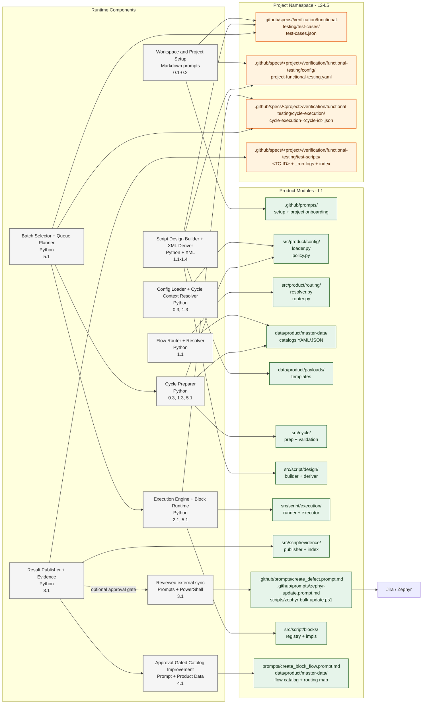

| Module | C3 Component | Code / Artifact Anchor | Technology | Responsibility | Ownership |
|---|---|---|---|---|---|
| src/product/config/ | Config Loader + Cycle Context Resolver | `src/product/config/loader.py` | Python | Resolve environment, cycle properties, workflow layers, and rule bundle context into executable context | Product-level |
| src/product/config/ | Policy Resolver | `src/product/config/policy.py` | Python | Enforce allowlist/protected-field policy and override validation from product/project rule bundles | Product-level |
| data/product/rules/ | Rule Definitions | `data/product/rules/product-rules.yaml` | YAML | Define product-level governance, reusable constraints, and enforcement policy inputs | Product-level |
| .github/specs/<project>/verification/functional-testing/ | Rule Definitions | `.github/specs/<project>/verification/functional-testing/config/project-functional-testing.yaml` | YAML | Define project-level test-case binding and evidence rules; an optional `config/project-rules.yaml` may supplement when present | Project-level |
| data/cycle/rules/ | Rule Definitions | `data/cycle/rules/cycle-rules.yaml` | YAML | Define cycle-level selection, preparation, and gating rules | Cycle-level |
| data/script/rules/ | Rule Definitions | `data/script/rules/script-rules.yaml` | YAML | Define script-level preparation, runtime, retry, and reporting rules | Script-level |
| src/product/routing/ | Order Type Block Flow Map Resolver | `src/product/routing/resolver.py` | Python | Resolve orderType + functionality to flow ID and policy | Product-level |
| src/product/routing/ | Test Block Flow Catalog Resolver | `src/product/routing/resolver.py` | Python | Resolve flow version and enforce constraints | Product-level |
| src/product/routing/ | Router | `src/product/routing/router.py` | Python | Unified flow selection combining resolver and project policy | Product-level |
| src/cycle/ | Cycle Preparer | `src/cycle/prep/cycle_preparer.py` | Python | Resolve selected test-case data offline for review; accept corrections; persist only approved prepared or deferred cycle handoffs; never call OMS/Klarna or execute workflows; apply cycle rules before handoff | Product-level |
| src/cycle/ | Data Lineage Recorder | `src/cycle/prep/data_lineage.py` | Python | Record the source and approved override token for every resolved value, including cycle-to-test-script handoff lineage and cycle-rule scope | Product-level |
| src/cycle/ | Cycle Validator | `src/cycle/validation/cycle_validator.py` | Python | Validate policy, resolved values, approval/deferred status, cycle rules, and readiness before handoff; deferred entries remain non-executable | Product-level |
| src/script/design/ | Script Builder | `src/script/design/script_builder.py` | Python | Consume approved cycle values as traceable overrides where present, resolve deferred values, and compose the L4 workflow/design from test-case intent and script rules | Product-level |
| src/script/design/ | Pseudo-Block Analyzer | `src/script/design/script_builder.py`, `src/script/design/script_validator.py` | Python | Derive the subphase 1.1 test-block-association table from test-case steps and catalogs, mark missing blocks for review, and validate required blocks, flows, and templates before design generation continues | Product-level |
| src/script/design/ | Flow Gap Resolver | `src/script/design/script_validator.py`, `src/product/routing/resolver.py` | Python | Identify missing block-flow or block-gap conditions, route them to the governed creation prompts, and keep the association table aligned before design generation continues | Product-level |
| src/script/design/ | XML Deriver | `src/script/design/xml_deriver.py` | Python + XML | Read the canonical template without mutation, preserve all inherited elements and attributes, apply only approved value substitutions, derive STS Store INT-13 template usage from the approved STS Store routing contract, validate the child against the source structure, and persist the prepared child and lineage only after validation succeeds | Product-level |
| src/script/design/ | Script Validator | `src/script/design/script_validator.py` | Python | Validate prepared XML, workflow input paths, and design contracts before execution; reject unauthorized template differences and script-guardrail violations | Product-level |
| src/script/execution/ | Workflow Runner | `src/script/execution/workflow_runner.py` | Python | Orchestrate step execution with gates and retries under script runtime rules | Product-level |
| src/script/execution/ | Step Executor | `src/script/execution/step_executor.py` | Python | Execute one step and capture results | Product-level |
| src/script/execution/ | Retry Policy Engine | `src/script/execution/retry_policy.py` | Python | Define and enforce retry semantics from script rules | Product-level |
| src/script/execution/ | Context Manager | `src/script/execution/context.py` | Python | Manage mutable run state across steps | Product-level |
| src/script/evidence/ | Result Publisher | `src/script/evidence/result_publisher.py` | Python | Publish run summary and evidence bundle under reporting rules | Product-level |
| src/script/evidence/ | Assertion Reporter | `src/script/evidence/assertion_reporter.py` | Python | Record assertion pass/fail artifacts | Product-level |
| src/script/evidence/ | Run Log Index Manager | `src/script/evidence/run_log_index.py` | Python | Persist and update run log index for discovery | Product-level |
| src/script/blocks/ | Block Runtime and Registry | `src/script/blocks/registry.py`, `src/script/blocks/*.py` | Python | Reusable block implementations (OMS, Klarna, Verify), including STS Store INT-13 template-backed transitions | Product-level |
| .github/prompts/ | Pseudo-block, flow, and block creation prompts | `.github/prompts/prep_test_script.prompt.md`, `.github/prompts/create_block_flow.prompt.md`, `.github/prompts/create_block.prompt.md` | Markdown | Governed review-first prompts that derive pseudo-block tables, approve flows, and create missing blocks before design generation continues | Product-level prompt surface |
| .github/specs/<project>/verification/functional-testing/test-scripts/<TC-ID>/test-script-design.md | Association table section | Embedded block-association table section | Markdown | Derived pseudo-block analysis table for each TC, used to gate flow and block creation before workflow generation; missing blocks are surfaced here for review and governed creation; subphase 1.1 writes this table and keeps the table status visible as available, missing, or review | TC-level design artifact section |
| `scripts/` and `.github/prompts/` | Integration Gateway / Sync Adapter | `scripts/zephyr-bulk-update.ps1`, `.github/prompts/create_defect.prompt.md`, `.github/prompts/zephyr-update.prompt.md` | PowerShell + Prompt | Send reviewed optional defect and status updates to external tracking systems | Product hook + Project operation |

### 4.5 Runtime Sequence Diagram

The runtime sequence below shows the handoffs between cycle context, project intent, script preparation, execution, and evidence. The C4 view above remains the source for component ownership and implementation boundaries.

Rule governance applies at each stage of this flow:
- Product rules constrain reusable catalogs, templates, policy resolution, and runtime guardrails.
- Project rules constrain test-case intent, approved case inputs, and project-owned evidence boundaries.
- Cycle rules constrain selection, preparation handoff, and cycle readiness before script preparation proceeds.
- Script rules constrain workflow preparation, runtime gates, retries, and evidence publication.

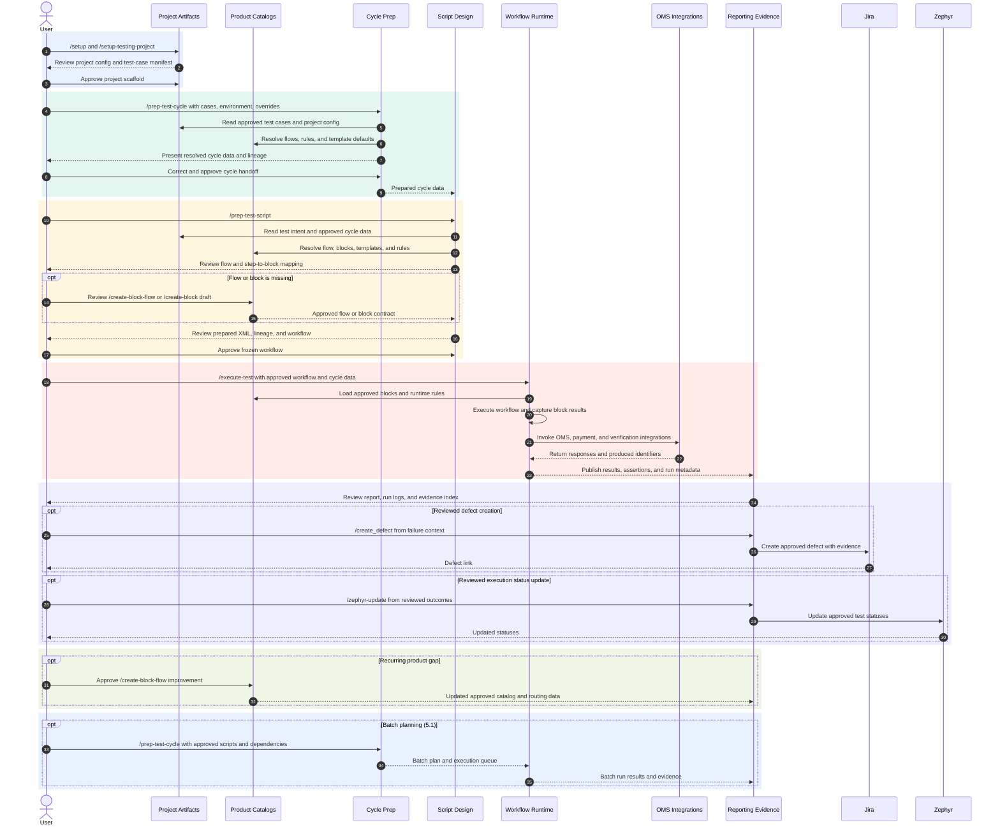

## 6. High Level ERD

ERD ownership interpretation:
- Read the ERD through the five-level model: L1 reusable catalogs, L2 scenario intent, L3 cycle context, L4 executable workflow, and L5 runtime evidence.
- Approved Jira defects and Zephyr status updates consume published run evidence; they are optional external actions, not persisted ERD entities in this product.
- The mixed areas are the transition points between those levels, not separate design centers.
- Rule governance is externalized through the rule documents and level-specific configuration; it is not modeled as a separate high-level ERD entity in this view.
- Rule bundles constrain the level they belong to, but they remain configuration inputs rather than persisted ERD rows.
- The pseudo-block table used by `/prep-test-script` is a derived analysis artifact built from `TEST_CASE_STEP`, `TEST_BLOCK`, and `TEST_BLOCK_FLOW`; it is not a standalone persisted ERD entity.
- The subphase 1.1 test-block-association table shown in the phase model is the user-visible form of that derived analysis artifact, and missing blocks are reported there for review rather than hidden from the workflow draft.
- The association table belongs to the Test Script Design artifact lifecycle, not to the persisted runtime ERD, and its status values are the governed bridge between design-time block discovery and later workflow generation.

Entity level assignment:

| Entity / Group | Conceptual Level | Phase / Subphase | Why |
|---|---|---|---|
| `MASTER_DATA`, `APPLICATION`, `APP_ENV`, `ORDER_TYPE_BLOCK_FLOW_MAP`, `TEST_BLOCK_FLOW`, `TEST_BLOCK`, `BLOCK_TEMPLATE`, `TEST_SEED_CATALOG`, `INPUT_PAYLOAD` | L1 - Testing Product | Setup: Cycle Setup (0.3)<br>Script Design: Test Case -> Block Flow Mapping/Discovery (1.1); Step -> Block Mapping (1.2); Data & XML Preparation (1.3)<br>Improvement: Product Improvement Loop (4.1) | Reusable product-owned catalogs, templates, and policies shared across projects. |
| `PROJECT`, `TEST_CASE`, `TEST_CASE_STEP` | L2 - Test Project | Setup: Project Setup (0.2); Cycle Setup (0.3)<br>Script Design: Test Case -> Block Flow Mapping/Discovery (1.1); Step -> Block Mapping (1.2)<br>Batch: Batch Planning & Execution (5.1) | Project-specific scenario intent, test cases, steps, and project rules. |
| `TEST_CASE_EXECUTION_DATA` | L2 - Test Project | Setup: Cycle Setup (0.3)<br>Script Design: Data & XML Preparation (1.3) | Test-case-owned environment and business data used to prepare one case, including order lines, amounts, identifiers, overrides, and rule binding. |
| `TEST_CYCLE`, `TEST_CASE_EXECUTION`, `TEST_CYCLE_CONFIG` | L3 - Test Cycle | Setup: Cycle Setup (0.3)<br>Execute: Approved Workflow Execution (2.1)<br>Batch: Batch Planning & Execution (5.1) | Cycle selection, environment binding, execution grouping, gating, and batch readiness. |
| `CYCLE_PREPARED_DATA` | L3 - Test Cycle | Setup: Cycle Setup (0.3)<br>Script Design: Data & XML Preparation (1.3)<br>Execute: Approved Workflow Execution (2.1)<br>Batch: Batch Planning & Execution (5.1) | Approved or deferred per-TC handoff with resolved values, prepared-input references, and lineage. It does not replace the test-case catalog as the case inventory, but when an approved entry exists for the requested TC, `/prep-test-script` must load and reconcile it before reporting missing test data. |

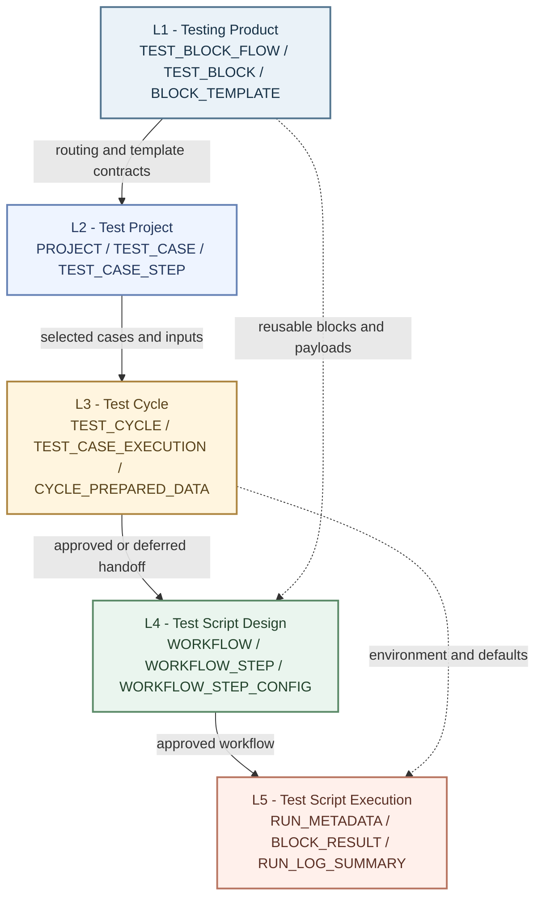

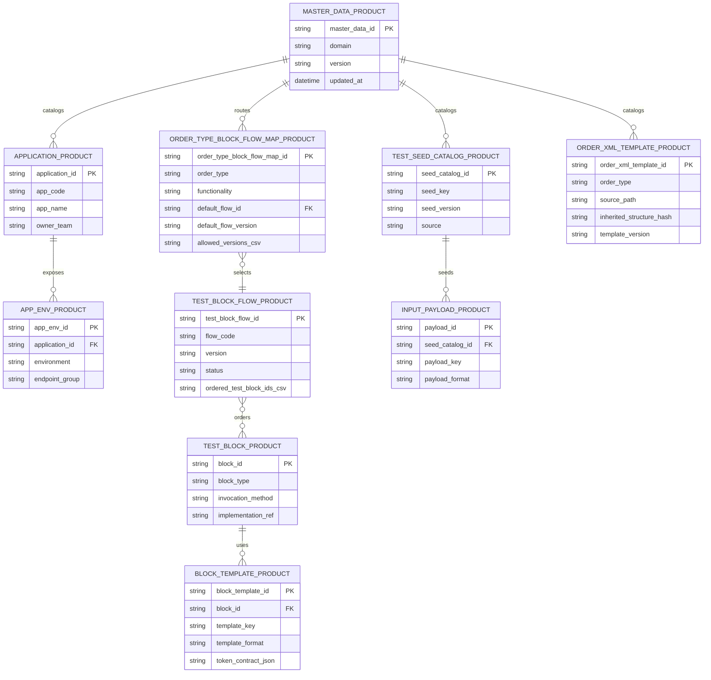

**Test project and scenario**

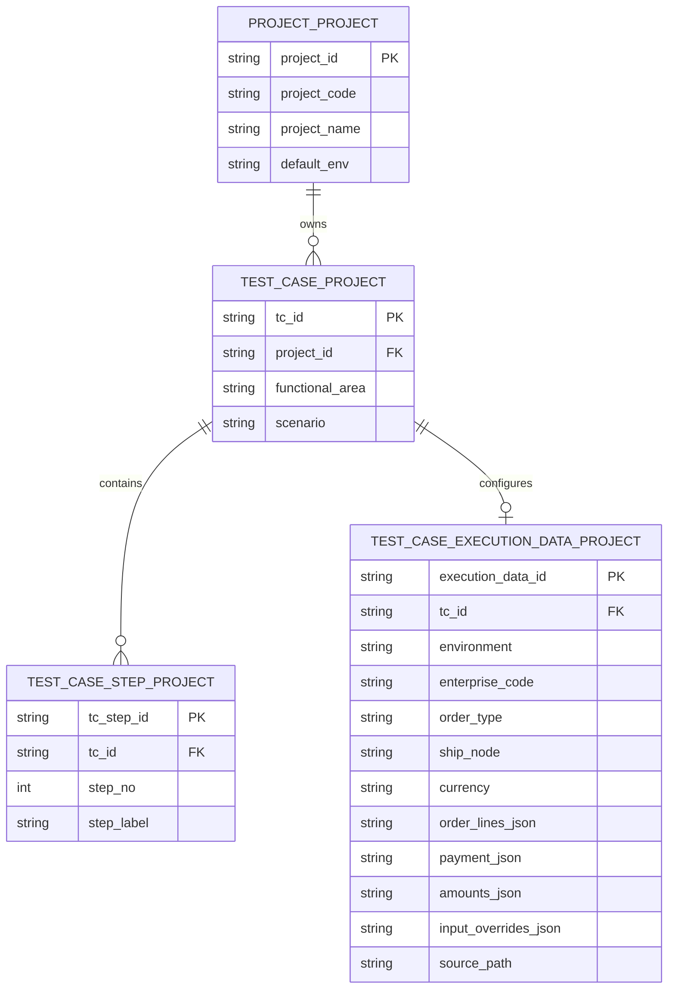

**Test script design**

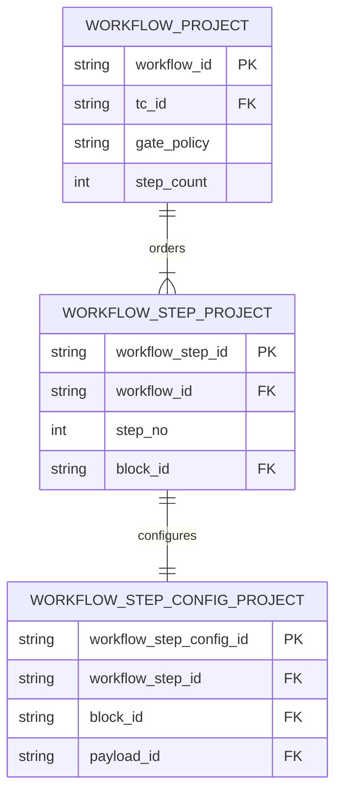

**Test cycle and prepared handoff**

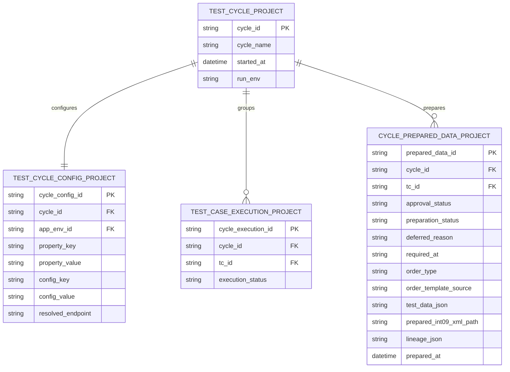

**Script execution and XML preparation**

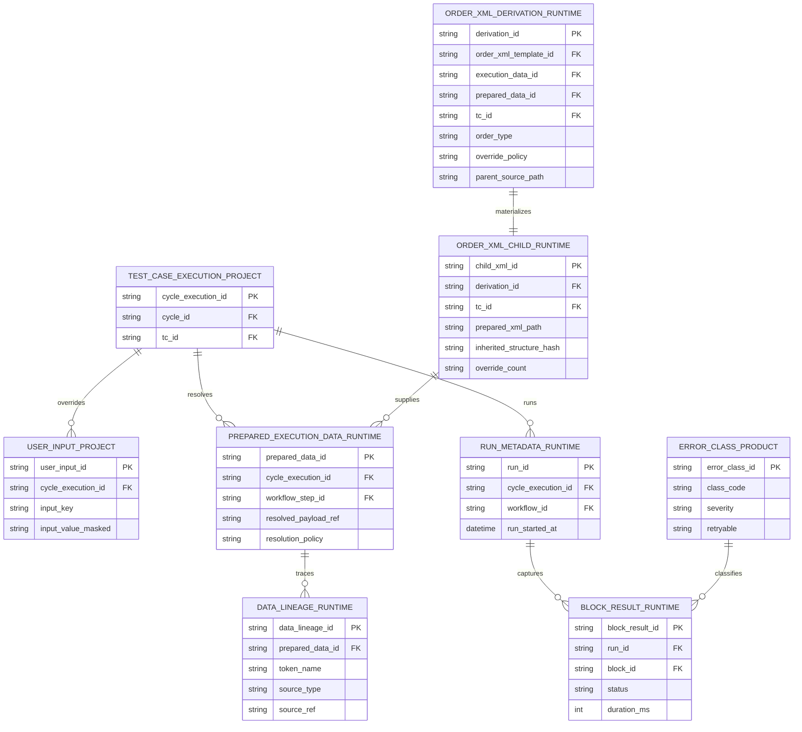

**Run reporting and evidence**

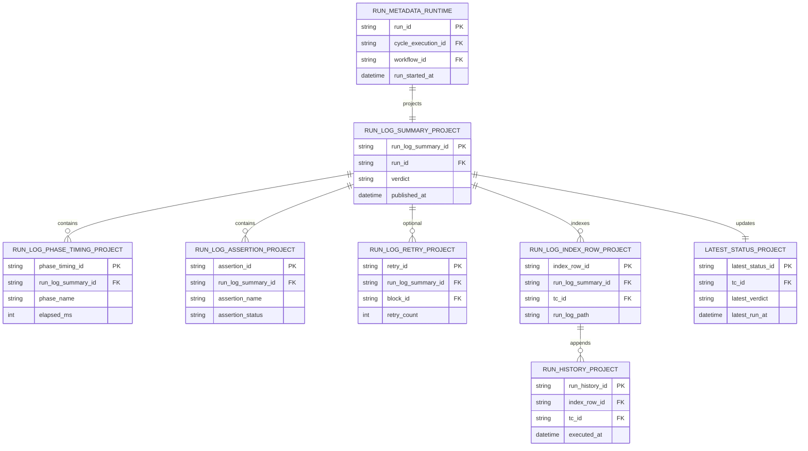

### 7.1 Entity-to-File Mapping (Core ERD Entities)

#### 7.1.0 Entity Catalogue: Hierarchical, Sequential, and File-Mapped

Entities are listed in the order they come into existence, grouped by the five conceptual levels.

---

**Level 1 - Testing Product** *(Reusable framework; owned by the product team; shared across all projects)*

| Entity | Answers | Summary | Primary Artifact |
|---|---|---|---|
| `ProductMaster` | What reusable capabilities does the testing product define? | Root catalog record owning all product-level catalogs. | `data/product/master-data/product-master.yaml` |
| `Application` | Which application systems are in scope for testing? | Named application system (e.g. OMS, Klarna). | `product-master.yaml`: `applications[]` |
| `AppEnvironment` | What environments does each application expose? | Environment endpoint and credential binding (e.g. Dev-1). | `product-master.yaml`: `applications[].environments[]` |
| `OrderTypeBlockFlowMap` | How does order type + functionality + fulfilling location route to a block flow? | Routing table mapping `orderType + functionality + fulfillingLocation` to a default and allowed flow versions. | `data/product/master-data/order-type-block-flow-map.yaml` |
| `TestBlockFlow` | What is the canonical ordered block sequence for a given flow? | Versioned ordered block sequence used as the execution pipeline. | `data/product/master-data/block-flow-catalog.yaml`: `flows[]` |
| `TestBlock` | What executable blocks are available to compose test scripts? | Reusable, versioned execution capability (e.g. `INT-01`). | `data/product/master-data/test-block-catalog.yaml` |
| `BlockTemplate` | What token contract and schema does each block define? | Template/schema that each block step resolves payload tokens against, including STS Store INT-13 `int13-sfs-sts-*` payloads. | `data/product/payloads/input-payloads.json` (token contract entries) |
| `OrderXmlTemplate` | Which parent order XML is selected for an order type? | Product-owned parent XML selected from the test-case `orderType`; its unmodified structure is inherited by a TC child XML. | `data/product/payloads/templates/block-templates/input-block-template/int09-*.xml` |
| `TestSeedCatalog` | What baseline test data seeds exist for block execution? | Product-owned baseline data (addresses, amounts, identifiers). | `data/product/master-data/test-seed-catalog.json` |
| `InputPayload` | What resolved payload structure does each block receive? | Prepared payload document consumed by block execution. | `data/product/payloads/input-payloads.json` |
| `FunctionalArea` | What business capability area does a test case belong to? | Canonical classification (e.g. `OM&F`) anchoring requirements-to-evidence traceability. | `.github/specs/<project>/verification/functional-testing/test-cases/test-cases.json`: `functionalArea` field |

---

**Level 2 - Test Project** *(Project-specific implementation; one per initiative e.g. Klarna BNPL)*

| Entity | Answers | Summary | Primary Artifact |
|---|---|---|---|
| `ProjectConfig` | What are this project's env, org, and policy settings? | Root project overlay owning enterprises, policies, and secret references. | `.github/specs/<project>/verification/functional-testing/config/project-functional-testing.yaml` |
| `Enterprise` | Which org codes does this project use? | Enterprise entry binding org code, ship node, and customer profile. | `.github/specs/<project>/verification/functional-testing/config/project-functional-testing.yaml`: `enterprises[]` |
| `ProjectPolicy` | What execution policies govern this project? | Policy overlays tuning engine behaviour (retry limits, gate rules). | `.github/specs/<project>/verification/functional-testing/config/project-functional-testing.yaml`: `policies` |
| `SecretRef` | What secrets does this project need? | Key references to credentials resolved at runtime from env vars or secret stores. | `.github/specs/<project>/verification/functional-testing/config/project-functional-testing.yaml`: `secrets` |
| `TestCase` | What business scenarios need to be tested? | One record per scenario; defines id, functional area, orderType, expected behaviour, and execution-data binding. | `.github/specs/<project>/verification/functional-testing/test-cases/test-cases.json` |
| `TestCaseExecutionData` | Which item IDs, quantities, amounts, and environment does this TC execute with? | Structured test-case-owned profile for environment, enterprise, ship node, order lines, payment identifiers, amounts, and input overrides. | `.github/specs/<project>/verification/functional-testing/test-cases/test-cases.json`: `testCases[].executionData` |
| `TestCaseStep` | What are the individual verifiable steps of each scenario? | Ordered step capturing description, test data intent, and expected result. | `.github/specs/<project>/verification/functional-testing/test-scripts/TC-XXX/test-script-design.md` |
| `DesignOrderedStep` | What is the approved block-chain design for this test case? | Prep-generated record linking each step to its approved block and params. It is derived from the pseudo-block analysis table, which is written into the embedded section of `.github/specs/<project>/verification/functional-testing/test-scripts/TC-XXX/test-script-design.md` for review before design generation continues. | `.github/specs/<project>/verification/functional-testing/test-scripts/TC-XXX/test-script-design.md` (design section) |

`OrderXmlDerivation` links the selected test-case `orderType`, `.github/specs/<project>/verification/functional-testing/test-cases/test-cases.json`, selected product parent XML, optional project defaults/user overrides, and token lineage. For create-order prep it also binds `AllocationRuleID` from enterprise, and `PaymentReference1` / `PaymentReference4` from the runtime Klarna order id as named runtime-derived fields. STS Store test cases additionally resolve the downstream `int13-sfs-sts-*` shipment template family through the same STS Store routing contract. `OrderXmlChild` is the resulting TC-owned XML at `.github/specs/<project>/verification/functional-testing/test-scripts/<TC-ID>/inputs/int09-order-create.xml`; execution consumes this child through workflow `xmlPath`.

---

**Level 3 - Test Cycle** *(A planned batch execution against a target environment and build)*

| Entity | Answers | Summary | Primary Artifact |
|---|---|---|---|
| `TestCycle` | What group of test cases ran together as a regression or validation run? | Cycle header: environment, build, selected TCs, overall status, timestamps. | `.github/specs/<project>/verification/functional-testing/test-scripts/index.md` (cycle grouping) |
| `TestCaseExecution` | Did this TC run in this cycle, and what was the aggregate outcome? | One row per TC per cycle: outcome, timestamp, duration. | `.github/specs/<project>/verification/functional-testing/test-scripts/TC-XXX/_run-logs/index.md` (per-run rows) |
| `TestCycleConfig` | What environment, org, overrides, and gate policy governed all scripts in this cycle? | Consolidated cycle-level configuration: env defaults, org/ship-node/customer profile, block overrides, gate policy, and app environment binding. All sourced from one project file. | `.github/specs/<project>/verification/functional-testing/config/project-functional-testing.yaml`: `cycleProperties` + `cycleConfiguration` + env overlay |
| `CyclePreparedData` | What batch validation/materialization evidence did `/prep-test-cycle` produce? | Derived per-TC handoff containing selected source, resolved values, prepared-input reference, and token lineage. It does not replace the test-case catalog as the case inventory, but when an approved entry exists for the requested TC, `/prep-test-script` must load and reconcile it before reporting missing test data. | `.github/specs/<project>/verification/functional-testing/cycle-execution/cycle-execution-<cycle-id>.json`: `preparedTestCases[]` |

---

**Level 4 - Test Script Design** *(The approved executable definition for one business scenario)*

| Entity | Answers | Summary | Primary Artifact |
|---|---|---|---|
| `Workflow` | What is the ordered block sequence that implements this test case? | Approved executable workflow per TC; one per TC per design approval. | `.github/specs/<project>/verification/functional-testing/test-scripts/TC-XXX/test-script-workflow.yaml` |
| `WorkflowStep` | What is the step number and block assignment for each step? | Ordered step entry linking sequence position to a block id. | `test-script-workflow.yaml`: `steps[]` |
| `WorkflowStepConfig` | What block, label, and params does each step use? | One config entry per step with `block` id, label, and resolved params. | `test-script-workflow.yaml`: `steps[].params` |

---

**Level 5 - Test Script Execution** *(Runtime and evidence artifacts produced when a test script runs)*

| Entity | Answers | Summary | Primary Artifact |
|---|---|---|---|
| `UserInput` | What runtime overrides did the user provide for this run? | Ephemeral override context applied with highest precedence; masked in persisted artifacts. | Runtime prompt/override context in run artifacts |
| `PreparedExecutionData` | What is the fully resolved payload for each step after precedence merge? | Runtime-consumable payload reference derived from test-case `executionData`; optional cycle-preparation output may validate or cache it but must not replace the test-case source. | `.github/specs/<project>/verification/functional-testing/runtime/run-metadata/*.json` (prepared payload refs) and `.github/specs/<project>/verification/functional-testing/test-cases/test-cases.json` |
| `DataLineage` | Where did each resolved token value come from? | Per-token source trace recorded during cycle preparation and carried into design/execution evidence (User Input / Test Case / Cycle / Template default). | `.github/specs/<project>/verification/functional-testing/cycle-execution/cycle-execution-<cycle-id>.json` and `.github/specs/<project>/verification/functional-testing/runtime/run-metadata/*.json` |
| `RunMetadata` | What was the full identity and context of this specific execution? | Run-scoped record: executor, machine, env, org, timestamps. Anchors all evidence. | `.github/specs/<project>/verification/functional-testing/runtime/run-metadata/*.json` |
| `BlockResult` | What did each step actually produce or fail with? | Per-step output: produced values, error class, retry disposition. Most granular evidence. | `.github/specs/<project>/verification/functional-testing/runtime/block-results/*.json` |
| `RunLogSummary` | What is the human-readable verdict for this run? | Top-level run log: result, key business IDs, env, duration, executor. | `.github/specs/<project>/verification/functional-testing/test-scripts/TC-XXX/_run-logs/*.md` |
| `RunLogPhaseTiming` | How long did each phase take? | Per-phase duration and status rows for performance triage. | `.github/specs/<project>/verification/functional-testing/test-scripts/TC-XXX/_run-logs/*.md`: phase timing section |
| `RunLogAssertion` | What field-level checks passed or failed? | One row per assertion: field, expected, actual, pass/fail. Explainable proof of correctness. | `.github/specs/<project>/verification/functional-testing/test-scripts/TC-XXX/_run-logs/*.md`: assertions section |
| `RunLogRetry` | Were any steps retried, and why? | Optional retry rows present only on retryable paths. | `.github/specs/<project>/verification/functional-testing/test-scripts/TC-XXX/_run-logs/*.md`: retry section |
| `RunLogIndexRow` | How does this run fit in the overall run timeline? | Denormalized index row enabling fast portfolio-level discovery. | `.github/specs/<project>/verification/functional-testing/test-scripts/index.md` |
| `LatestStatus` | What is the current live status of this test case design? | Latest-run snapshot written back to the design file. | `.github/specs/<project>/verification/functional-testing/test-scripts/TC-XXX/_run-logs/index.md` |
| `RunHistory` | What does the longitudinal run record look like? | Append-only history rows per run for trend and regression analysis. | `.github/specs/<project>/verification/functional-testing/test-scripts/index.md` and `TC-XXX` history blocks |

---

## 8. Folder Structure by Ownership

This section is the required folder contract for the new design and is aligned to the traceability
matrix lifecycle (Planning, Preparation, Execution, Results, External Coordination).

### 8.1 Folder Structure for Maintaining Code and Data

This section shows the maintained product and project-owned execution paths. Project-specific and generated artifacts appear only when needed. The active source of truth for test-case selection is `test-cases.json`.

**Product**

```text
.github/specs/functional-testing-product/
    01-intent/
    04-design/
    05-implementation/
    data/
        product/
            config/
            master-data/
                payment-method-entity-attribute-mapping.yaml
            payloads/
            rules/
        cycle/
            rules/
        script/
            rules/
        project/
            templates/
            project-rules.yaml
    src/
        cycle/
            config/
                rules/
            prep/
                cycle_preparer.py
                data_lineage.py
                execution_plan.py
            validation/
                cycle_validator.py
        product/
            config/
                env.py
                loader.py
                policy.py
            routing/
                resolver.py
                router.py
        project/
            artifacts/
                <project>/
                    helpers/
                    create_order_from_auth_token.py
                    create_klarna_order.py
                    get_auth_token.py
                    klarna_session.py
                    widget_server.py
            test_new_design_integration.py
        script/
            blocks/
                base_block.py
                klarna.py
                oms.py
                registry.py
                verify.py
            core/
                block_labels.py
                context.py
                execution_engine.py
                models.py
                policies.py
                state_store.py
                timer.py
                workflow_validation.py
            design/
                artifact_lifecycle.py
                script_builder.py
                script_validator.py
                xml_deriver.py
            execution/
                context.py
                retry_policy.py
                step_executor.py
                workflow_runner.py
            evidence/
                assertion_reporter.py
                result_publisher.py
                run_log_index.py
            sessions/
            engine.py
            execute_workflow.py
    test-generation/
```

Command prompts live at the repository root in `.github/prompts/`, outside `functional-testing-product/`.

**Project**

Canonical layout for new or updated project artifacts (for example, HPF-001). Existing KlarnaProject artifacts still use `config/project.yaml` and TC-root `int09-order-create.xml` files; do not treat those legacy paths as the target for new writes or assume they have been migrated.

```text
.github/specs/<project>/verification/functional-testing/
    assets/                     (project-specific, when needed)
    config/
        project-functional-testing.yaml
        klarna-binding.yaml     (project-specific, when needed)
    cycle-execution/
        cycle-execution-<cycle-id>.json
    env_certs/
        <env>-client-cert.pem    (when mTLS is required)
        <env>-client-key.pem     (when mTLS is required)
    helpers/                    (project-specific, when needed)
    runtime/
        assertions/
        block-results/
        run-metadata/
        state-snapshot/
    test-cases/
        test-cases.json
    test-scripts/
        index.md                (project-wide index, when present)
        <TC-ID>/
            _run-logs/
                index.md
            test-script-design.md
            test-script-workflow.yaml
            inputs/
                int09-order-create.xml
```

**Rationale:**
- `functional-testing-product` holds reusable product code, shared catalogs, and shared rules.
- `data/product/`, `data/cycle/`, `data/script/`, and `data/project/` separate the shared data domains.
- `src/cycle/`, `src/product/`, `src/project/`, and `src/script/` separate the reusable runtime and design code paths.
- `<project>/verification/functional-testing/` holds the project-owned config, test-case source, cycle outputs, runtime evidence, certificates, and per-TC execution artifacts.
- `test-scripts/<TC-ID>/_run-logs/` owns the per-test-case execution history.
- `.github/prompts/` remains outside the reusable module trees. Approved mTLS prep writes only the PEM pair; any existing PFX is legacy material, not a canonical output.

## Appendix

### A. C4 Model Quick Reference

| Level | Focus | Example |
|---|---|---|
| C1 | External actors and systems | QA Engineer, OMS, Jira, Zephyr |
| C2 | Major runtime containers | Setup, prep, execution, results, sync |
| C3 | Runtime components | Loader, resolver, binder, engine, publisher |
| C4 | Implementation files | `loader.py`, `execution_engine.py`, `result_publisher.py`, workflow YAML, run logs |

### B. Flow Governance Reference

| Item | Summary |
|---|---|
| Resolution key | `orderType + functionality`, with an optional scenario selector that takes precedence for specialized flows such as S0 auth hold |
| Default rule | Use the Product default flow when no allowed project override exists |
| Validation rule | Fail closed when flow version or order validation is invalid |
| Evidence fields | `requested_flow_version`, `resolved_flow_version`, `flow_resolution_source`, `flow_resolution_rule` |
| Policy toggles | `allow_project_flow_version_override`, `strict_block_order_validation` |
| Reference docs | `testing-strategy-design.md` |

## Version History

Maintain this table for every future revision. Add a new row for each approved update; do not rewrite or remove earlier entries.

| Version | Requested Changes | Implemented Changes | Summary |
|---|---|---|---|
| 1.0 | Establish the functional testing product test-execution design. | Defined the five-level architecture model, ownership boundaries, execution flow, preparation contracts, ERD relationships, folder structure, and flow-governance references. Established foundational DNA governance: (a) Ship-node resolution precedence (user override > test-case > cycle > template); (b) User-input allowlist policy (approved fields only; protected fields require explicit policy); (c) Cycle preparation gate contract (offline review-first; no live calls; explicit approval required before persistence). | Initial test-execution system design baseline with foundational governance DNA. |
| 1.1 | Ensure block-template inputs, including create-order inputs, cannot have attributes or structure added or deleted; allow only user-provided test-data values at test-cycle or test-script level. | Added Template Immutability DNA; required value-only substitution from approved test-cycle or test-script inputs; added structure and attribute validation, fail-closed preparation, lineage requirements, validated prepared-child execution, and the Template Immutability Validator responsibility. | Added immutable-template and approved-value-only preparation governance. |
| 1.2 | Consolidate and modularize product-level implementation into focused domain-specific modules to improve maintainability, testability, and reusability. | Reorganized product framework into modular structure: src/product/config/ (loader, policy), src/product/routing/ (flow resolution), src/cycle/ (cycle prep, validation), src/script/ (design, execution, evidence). Updated C3 component diagram to show modular boundaries. Updated C4 code-view to map components to new module file paths. Consolidated Section 8 folder structure to reflect new organization. Separated project-owned artifacts under project/ namespace. All existing governance DNA (v1.0-1.1) remains unchanged and applies uniformly across new modules. | Modular architecture consolidation; improved code organization without changing execution semantics or governance rules. |
| 1.3 | Align the architecture blueprint and high-level architecture references with the implemented modular ownership layout. | Updated Sections 2 and 4 to reference product master data/payloads, project config/runtime/test-case artifacts, product configuration, script execution/evidence, and retained framework block/core boundaries. | Canonical path alignment for the architecture-to-code-to-data traceability view. |
| 1.4 | Align the ERD/file mapping and command prompts with the canonical product/project ownership structure. | Updated Section 7 entity artifacts and Section 8 runtime ownership to use product and project paths; added canonical-path overrides to `/prep-test-script` and `/execute-test`; removed the obsolete per-design technology-table requirement from execution conformance. | Design and command-path alignment for canonical preparation, execution, and evidence artifacts. |
| 1.5 | Make each test case artifact boundary the sole owner of its executable workflow. | Reclassified `test-script-workflow.yaml` under `.github/specs/<project>/verification/functional-testing/test-scripts/<TC-ID>/` as the authoritative WORKFLOW artifact; removed the duplicate project config workflow layer; aligned loader discovery and command-path overrides. | Artifact-local workflow ownership and execution resolution. |
| 1.6 | Complete the canonical Klarna authorization bootstrap migration. | Added the project-owned session, widget server, Playwright token capture, authorization-to-order conversion, orchestration, helper, widget, and shipment assets under `.github/specs/<project>/verification/functional-testing/test-scripts/`; removed active framework dependence on the legacy DMI-551 runtime root. | Klarna bootstrap execution is canonical-project owned; the legacy tree remains historical evidence only. |
| 1.6 | Add a safe auth-hold execution path for the S0 STH scenario. | Added scenario-aware S0 routing to `sth-auth-hold-klarna:v1`, reusable auth-hold OMS read-back and VER-09 reconciliation, the auth-hold read-back template, and TC-001 artifact-local workflow/design/input artifacts. | Auth-hold verification without shipment or capture behavior. |
| 1.7 | Ensure `/prep-test-script` consumes approved cycle data before reporting missing test data. | Made the approved `.github/specs/<project>/verification/functional-testing/cycle-execution/cycle-execution-<cycle-id>.json` handoff a mandatory lookup for matching `preparedTestCases[].tcId` entries, defined reconciliation and precedence rules, and aligned the prep prompt and cycle-prepared-data contract. | Approved cycle execution data is now an explicit canonical input to per-TC script preparation. |
| 1.8 | Implement the Template Immutability Validator to enforce value-only overrides and fail closed on canonical template structural drift. | Expanded the `mutable` attribute allowlist in `script_validator.py` `_compare_template()` to permit approved test-data value changes (OrderNo, ExtnCustomerNo, ExtnMerchantId, AddressLine1, ZipCode, etc.) while maintaining fail-closed enforcement against structural mutations (missing elements, added elements, protected attribute changes). Added regression test coverage for value-only overrides and structural drift detection. The validator now permits block-template folder overrides that change only mutable values, rejecting any changes to protected attributes or element structure before runtime. | Template Immutability Validator implementation with approved-value-only override path and fail-closed structural guardrail. |
| 1.9 | Add explicit STS Store INT-13 block-template binding for STS order cases. | Clarified the DNA, C4 block-runtime row, and `OrderXmlDerivation`/`BlockTemplate` mapping so STS Store INT-13 transitions use the `int13-sfs-sts-*` family and the store JSON payload path. | STS Store routing and template-family binding made explicit in the canonical design. |
| 1.10 | Add explicit product/project/src/cycle/script rule governance to the system design. | Clarified the architecture DNA, high-level architecture, and high-level ERD so the four rule levels are explicit and aligned to the new rules document. | Rule hierarchy now appears as a first-class architecture constraint across the top-level design. |
| 1.11 | Add rule-bundle visibility to the high-level architecture and ERD views. | Updated C1, C2, C3, and C4 to show rule bundles and rule-resolving responsibilities, and clarified that rule bundles are configuration inputs rather than ERD entities. | High-level architecture now exposes rule sources without adding fake entities to the ERD. |
| 1.12 | Add low-level rule-bundle propagation to runtime sequence, component maps, and ERD summaries. | Updated low-level C1/C2/C3/C4 and low-level ERD summaries to surface rule-bundle flow and rule-aware responsibilities without creating new ERD entities. | Low-level design now traces rule scope through prep, execution, evidence, and governance artifacts. |
| 1.13 | Align `/prep-test-script` with the internal pseudo-block-table, block-flow gap, and block-gap review gates. | Updated the slash-command map so prep explicitly performs pseudo-block-table analysis internally, updates the block-association table, and escalates missing block-flow or block conditions before script generation. | Prep workflow now reflects the governed internal analysis and approval gates that precede design generation. |
| 1.14 | Reflect the internal pseudo-block-table gate in the high-level architecture and ERD view. | Updated the high-level architecture, C2/C3 mapping, and ERD notes so the pseudo-block table is treated as a derived preparation artifact that gates block-flow and block-gap review before workflow generation resumes. | High-level design now shows the prep analysis responsibility without introducing a new persisted ERD entity. |
| 1.15 | Propagate the pseudo-block-table gate into the low-level sequence, implementation mapping, and ERD file contract. | Updated the low-level runtime sequence to show internal pseudo-block analysis, block-flow/block-gap escalation, and the derived association-table artifact; added prompt and table-file mappings to the low-level code/artifact view. | Low-level design now traces the governed prep gate through the concrete design, prompt, and artifact boundaries. |
| 1.16 | 2026-10-01: Align the design DNA and traceability matrix; Step -1 approved by the user (no JIRA ID supplied). | Corrected the DNA matrix reference; added missing-flow review and optional Jira/Zephyr reporting commands to affected matrix rows; aligned execution evidence paths to `_run-logs/`. | Step -1 DNA and matrix alignment only; downstream design review remains approval-gated. |
| 1.17 | 2026-10-01: Align high-level architecture and ERD with the approved matrix; Step 2 approved by the user (no JIRA ID supplied). | Updated C1 commands and optional tracker handoff; C3 missing-flow and reviewed external-sync handoffs; C3/C4 evidence paths and C4 adapter mapping. Clarified that external actions are not persisted ERD entities; kept C2 and ERD relationships unchanged. | Step 2 high-level alignment only; low-level design remains approval-gated. |
| 1.18 | 2026-10-01: Align low-level sequence and C4 mapping with the approved matrix; Step 3 approved by the user (no JIRA ID supplied). | Used the actual `/setup` prompt in the runtime sequence, added optional reviewed defect and Zephyr updates after report review, and corrected the C4 prep-prompt path to `.github/prompts/`. Kept ERD entities and relationships unchanged. | Step 3 low-level alignment only; implementation remains approval-gated. |
| 1.19 | 2026-10-01: Step 4 impact review approved by the user (no JIRA ID supplied). | Confirmed the approved design alignment needs no data or code changes; existing commands and per-TC `_run-logs/` contract remain in place. | No implementation files changed; automatic external synchronization is outside this request. |
| 1.20 | 2026-10-01: Align the folder contract with the current repository layout. | Documented script execution and evidence modules, moved the prompt reference to repository-level `.github/prompts/`, clarified optional project directories and canonical PEM outputs, and removed nonexistent runtime state and product-local prompt entries. Distinguished legacy KlarnaProject paths from the canonical project tree. | Folder structure documentation only; no project artifacts or code moved. |
