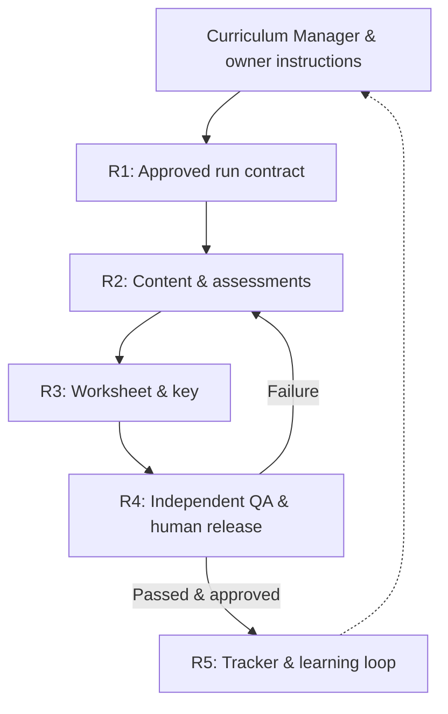
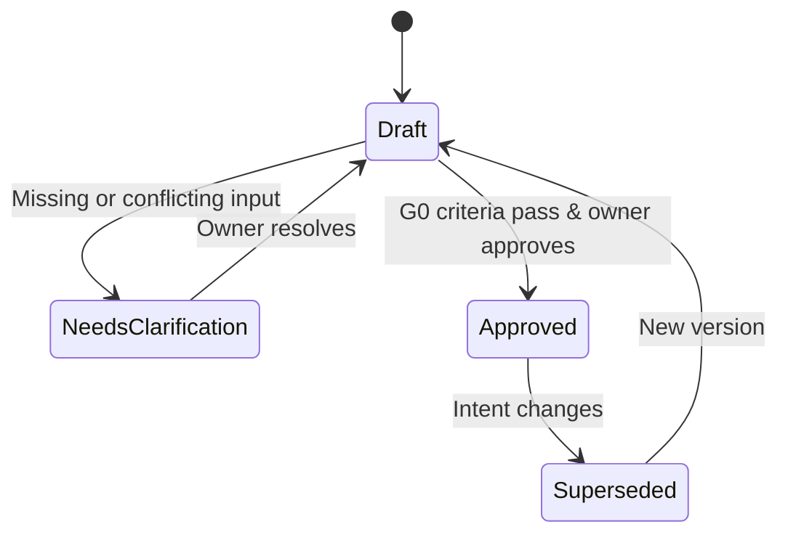

# MTS ELA Worksheet Generation — Requirements

> **Status:** R1 proposed for human review; R2–R5 pending · **Version:** 0.1 · **Date:** 2026-11-05  
> **Product owner:** Krishna Chaitanya / MTS · **Upstream:** `PRODUCT.md` v1.1 and ELA Business Architecture v0.1  
> **Scope:** All ELA (reading comprehension, vocabulary, grammar, writing); RC is the first mature implementation.  
> **Approved product constraints:** Two-page worksheet/key **target**, readability first; **human** final release authorization.

## 1. At a glance: requirements roadmap

**Simple explanation:** Before creating a worksheet, we need an unambiguous *order form*. R1 defines that order form: which week, which grades, what to teach, which sources, how many of each question, and who approved it. Later stages must build and check against the exact same form.



| Slice | Purpose | Status |
|---|---|---|
| **R1** Curriculum & Run Intake | Freeze an explicit, verifiable weekly contract | **Drafted below** |
| **R2** Source, Content & Assessment | Make faithful, grade-appropriate passages, items and explanations | Planned |
| **R3** Artifact Assembly & Print | Produce paired, readable student/key files | Planned |
| **R4** Verification & Release | Verify every applicable AC, record evidence, secure approval | Planned |
| **R5** Tracking & Continuous Learning | Record released coverage, defects and regression learning | Planned |

**R1 exit condition:** One human-approved `run-manifest` snapshot exists; every active grade has complete, validated requirements; conflicts and unknowns are resolved or explicitly blocked. G0 (Intent Ready) must not pass by inference.

## 2. R1 — Contract and boundaries

### 2.1 Core entities

| Entity / key | Minimum fields and semantics |
|---|---|
| **Run** | `run_id`, scheduled week/date range, issuance date/timezone, curriculum snapshot ID/version, configuration version, status, requester, approver, approval timestamp |
| **Grade scope** | Exact grade ID, explicit state `GENERATE` / `DO_NOT_GENERATE`; reason for exclusion where applicable |
| **Learning objective** | Stable curriculum objective ID, grade, target skill/topic, intended depth, priority, measurable evidence of coverage |
| **Source policy** | Approved source(s), author/title when relevant, locator (page/cell/line), excerpt/genre/length constraints, usage/provenance decision |
| **Assessment policy** | Active domain(s), item types, quotas (by passage or worksheet), difficulty, response format, rubric version, exceptions |
| **Artifact policy** | Student/key required, naming convention, print profile, two-page target, QA report format, publication destination |
| **Decision / exception** | Decision ID, issue, proposed resolution, rationale, owner, severity, authorization, timestamp and affected requirements |

Unknown fields have explicit **MISSING / CONFLICT / PENDING APPROVAL** states; they are never filled from a prior week's defaults without an authorized configuration reference.

### 2.2 Scope state machine



Only the **Approved** version may feed generation. Any substantive post-approval change must create a new version and rerun all affected downstream checks.

## 3. Atomic R1 requirements

Each row has one testable obligation. Acceptance criteria are intentionally specific; examples and thresholds remain configuration-driven rather than invented universal policy.

| Requirement ID | Requirement (shall) | Acceptance criterion ID and checkable condition |
|---|---|---|
| **ELA-R1-001** | The system shall identify each run by a unique stable ID and a dated weekly scope. | **ELA-AC-R1-001**: ID, dates, timezone and curriculum snapshot are present and valid; the same ID is used by all downstream artifacts. |
| **ELA-R1-002** | The system shall treat the authoritative curriculum snapshot and explicit owner-approved overrides as the only sources of weekly scope. | **ELA-AC-R1-002**: Each active objective resolves to a source record or recorded approved override, including version and locator. |
| **ELA-R1-003** | The system shall require an explicit scope state for each considered grade. | **ELA-AC-R1-003**: Each considered grade is classified GENERATE or DO_NOT_GENERATE; no unclassified grade enters production. |
| **ELA-R1-004** | The system shall exclude grades not marked GENERATE from production and active QA denominators. | **ELA-AC-R1-004**: Output-manifest grade set equals approved GENERATE set; excluded grades are listed separately as OUT OF SCOPE, not NOT VERIFIED. |
| **ELA-R1-005** | The system shall capture each active grade's intended objectives, genres and ELA domains. | **ELA-AC-R1-005**: Every active grade has at least one approved objective and explicit applicability/absence for RC, vocabulary, grammar and writing; missing mandated objectives block approval. |
| **ELA-R1-006** | The system shall capture source selection constraints and provenance policy before sourcing begins. | **ELA-AC-R1-006**: Source/genre/length/location/usage requirements are represented or explicitly marked unrestricted/not applicable with approval; contradictory constraints are unresolved blockers. |
| **ELA-R1-007** | The system shall record quantitative assessment requirements as machine-checkable configuration. | **ELA-AC-R1-007**: Every applicable item type has an unambiguous quantity or range, quota level (per passage/per worksheet), format, difficulty/rubric reference and configuration provenance. |
| **ELA-R1-008** | The system shall capture layout, artifact and publication requirements in the approved contract. | **ELA-AC-R1-008**: Student/key pair, naming template, print profile, two-page target, readability precedence, QA outputs and destination are explicit or approved as not applicable. |
| **ELA-R1-009** | The system shall resolve contradictions, missing mandatory values and ambiguous instructions before G0 approval. | **ELA-AC-R1-009**: Validation reports zero unresolved mandatory errors; every exception has a disposition and authorized owner. |
| **ELA-R1-010** | The system shall record a named human's approval of the exact immutable contract version before generation. | **ELA-AC-R1-010**: Approver identity, decision, timestamp, version identifier and content hash are recorded; unsigned/modified versions are ineligible for generation. |
| **ELA-R1-011** | The system shall preserve traceability from approved curriculum objectives to downstream coverage verification. | **ELA-AC-R1-011**: Each active objective and quota has a stable ID and trace anchor usable by generated question/passage manifests and QA evidence. |
| **ELA-R1-012** | The system shall version and revalidate affected inputs after a post-approval change. | **ELA-AC-R1-012**: Change produces new contract version, supersedes old approval and records impacted downstream steps; no stale approval authorizes changed outputs. |

**Scope clarification:** “Every considered grade” means grades listed by the run request or the approved curriculum matrix for that run. The schema must not infer that all grades 1–12 belong to every run.

## 4. Verification criteria, tests and evidence

Each AC links to an independently performed verification. The following tests are *specified, not implemented or executed*. Expected evidence structure is part of the contract.

| AC | Verification ID / method | Test ID | Required evidence |
|---|---|---|---|
| 001 | **VC-R1-001** Validate run schema, date window, identifiers | **TC-R1-001** | Run ID, parse results, curriculum snapshot, field errors |
| 002 | VC-R1-002 Reconcile each objective to snapshot/override | TC-R1-002 | Objective→record locator and version |
| 003 | VC-R1-003 Check grade-state exhaustiveness/exclusivity | TC-R1-003 | Grade→state table, missing/duplicate states |
| 004 | VC-R1-004 Compare active set vs proposed output set | TC-R1-004 | Expected/actual grade IDs; excluded-grade list |
| 005 | VC-R1-005 Validate objective/domain matrix per active grade | TC-R1-005 | Grade×domain applicability and objective IDs |
| 006 | VC-R1-006 Validate source-policy completeness and consistency | TC-R1-006 | Source policy, conflicts, permissions/usage state |
| 007 | VC-R1-007 Type- and range-check configured assessment quotas | TC-R1-007 | Per-type expected quotas, levels and provenance |
| 008 | VC-R1-008 Inspect output and print/publish configuration | TC-R1-008 | Artifact requirements, pagination/readability, destination |
| 009 | VC-R1-009 Run unresolved-blocker/exception policy audit | TC-R1-009 | Blockers, dispositions, authorities |
| 010 | VC-R1-010 Verify human approval signature-to-hash binding | TC-R1-010 | Approver, hash/version, decision and timestamp |
| 011 | VC-R1-011 Check trace IDs for uniqueness and referential validity | TC-R1-011 | Objective/assessment anchor inventory |
| 012 | VC-R1-012 Simulate approved-version mutation and ensure invalidation | TC-R1-012 | Before/after versions, invalidated approval and impact list |

**Verification independence:** A generator's self-reported success is not sufficient evidence. Deterministic checks inspect the stored contract and manifest, and an independent reviewer confirms educational choices and ambiguous policy resolutions.

### G0 — Intent Ready decision table

| Condition | Gate result |
|---|---|
| All 12 applicable R1 checks pass; no unresolved mandatory conflicts; exact version human-approved | **PASS** |
| Any mandatory check fails or lacks evidence | **BLOCKED** |
| A requirement genuinely does not apply, with approved reason | **NOT APPLICABLE** for its row; not silent omission |
| Grade explicitly excluded | **OUT OF SCOPE** in separate grade section, not a failed/unverified check |
| Reviewer requests change | **REVISION REQUIRED**; issue next contract version and rerun checks |

**Implementation caveat:** The 12 checks above are the initial R1 acceptance baseline, not yet a certification claim. They require implementation and execution before G0 can be called PASS.

## 5. Worked example: a weekly ELA order

**Illustrative only — not an approved weekly run:**

```yaml
run_id: ELA-2026-11-09-R01
week_start: 2026-11-09
timezone: America/New_York
curriculum_snapshot: "CM-2026-11-09@v3"
grade_scope:
  - {grade: 4, state: GENERATE}
  - {grade: 6, state: GENERATE}
  - {grade: 5, state: DO_NOT_GENERATE}
grades:
  "4":
    domains: [reading_comprehension, vocabulary]
    objectives: ["ELA-G4-RC-INFERENCE"]
    assessment:
      vocabulary_in_context: {count: 2, level: per_passage}
  "6":
    domains: [reading_comprehension, vocabulary]
    objectives: ["ELA-G6-RC-POETRY"]
    assessment:
      vocabulary_in_context: {count: 2, level: per_passage}
artifact_policy:
  student_pdf: true
  teacher_key_pdf: true
  page_target_each: 2
  pagination_priority: readability
release:
  authority: named_human
  approval_status: PENDING
```

This example illustrates **configuration, not confirmation** that the cited week, grades, objectives or quotas have been approved. The real weekly manifest must derive those fields from the authorized Curriculum Manager and owner instructions.

## 6. Business architecture linkage

| R1 requirement group | Value stream | Capabilities | Process | Rule(s) | Gate |
|---|---|---|---|---|---|
| R1-001–003, 005–008 | VS-01 | ELA-C01 | P-01 | BR-01 plus detailed run policy | G0 |
| R1-004 | VS-01 | ELA-C01, ELA-C06 | P-01/P-04 | BR-01 | G0 |
| R1-009–010, 012 | VS-01 | ELA-C01, ELA-BA-C09 | P-01/P-05 | BR-06, BR-07 adapted for intake | G0 |
| R1-011 | VS-01, VS-02 | ELA-C01, ELA-BA-C02 | P-01/P-06 | BR-08 | G0 |

**Important separation:** G0 approval authorizes *generation against an intake contract*. It does **not** authorize publication. G4 requires a separate named human release decision after all relevant QA gates.

## 7. Review and next drill-down

**Review decisions still needed:**

1. **Scope registry:** Which curriculum matrix/source is authoritative for each weekly run, and how are owner overrides approved?
2. **Grade defaults:** Must the request list every considered grade, or should the authoritative matrix generate a prefilled grade-scope list that the owner approves?
3. **Assessment policy:** Which grade/domain templates are preapproved, and when must weekly overrides be explicitly signed?
4. **G0 approval:** Who can approve the intake contract, and is it the same human role as final release authorization?
5. **Exceptions:** What classes of incomplete source or assessment information are waivable, if any?

**Next development slice:** R2 — Source, Content & Assessment, including provenance checks, grade-specific item quotas, ambiguity/distractor checks, evidence-based key explanations and poetry-enhanced PQYA rubric. R2 must consume the exact approved R1 manifest, not a regenerated interpretation of a chat request.

---

**Trace conventions:** `ELA-R1-NNN → ELA-AC-R1-NNN → VC-R1-NNN → TC-R1-NNN → evidence → G0`. IDs are persistent across revisions; changed meaning gets a new ID. All evidence must record expected, observed, result, run/version, timestamp and verifier.
