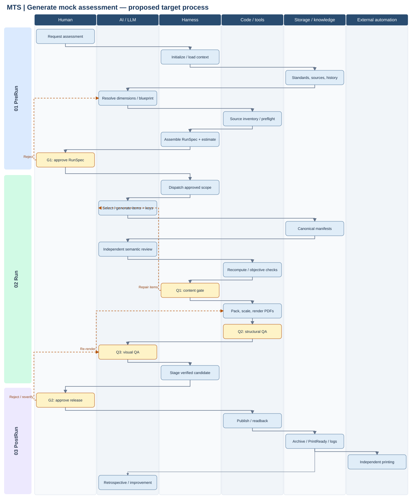

# Generate mock assessment

**Status:** The initial three-profile historical source-based benchmark milestone is verified: 76/76 mandatory criteria. The revised swimlane reflects that implemented scope and the pending human release boundary. Broader diagnostic, custom, generated and hybrid capabilities described below remain target specifications. See [the verification report](../../outputs/verification-report.md).

[Open scalable swimlane](./end-to-end-swimlane.svg) | [Diagram guide](./end-to-end-swimlane.md) | [Configuration and presentation](./configuration.md) | [Verification and regression](./verification.md)

## Purpose and architecture

Generate benchmark and diagnostic assessments for Math and ELA using the shared MTS Software Factory. Assessment blueprint, rather than weekly curriculum progression alone, drives composition. Reuse existing source acquisition, subject-specific generation, rendering, QA, RunSpec, storage and release capabilities. See [weekly practice](../generate_weekly_practice_worksheets/), [Math](../generate_math_worksheets/) and [ELA](../generate_ela_worksheets/). This does not replace existing subject policies.

Benchmark measures readiness against a target; diagnostic identifies skill gaps. Full, mini and custom describe academic length independently of purpose, source, coverage and physical page count. See configuration.md.

## Responsibility model

| Lane | Responsibility |
|---|---|
| Human | Intent, educational judgment, RunSpec and release approval, exceptions |
| AI / LLM | Blueprint, source selection, composition, independent semantic review, repair |
| Harness | Context, sequencing, gates, retries, state |
| Code / tools | Deterministic checks, recomputation, layout, PDF generation and publication |
| Storage / knowledge | Standards, sources, history, configs, artifacts, evidence |
| External automation | Existing Windows print function, independent of factory |

Human decides; AI reasons; harness coordinates; code executes and verifies; storage remembers.

## L2 lifecycle

| ID | Lane | Activity | Output |
|---|---|---|---|
| P01 | Human | Request assessment and target exam or skill | Intent |
| P02 | Harness | Initialize run; retrieve standards, policies, prior assessments, presets | Context |
| P03 | AI | Resolve purpose, length, scope, grade, timing, source mode | Assessment configuration |
| P04 | AI / tools | Acquire candidate source papers, keys, books; inventory questions/passages and assets | Source manifest |
| P05 | AI | Design blueprint: coverage, counts, difficulty, scoring, selection | Blueprint |
| P06 | AI / tools | Preflight source completeness, permissions, suitability, constraints, presentation feasibility | Preflight |
| P07 | Harness | Estimate runtime and assemble RunSpec PDF/JSON | Draft RunSpec |
| G1 | Human | Approve RunSpec or return to planning | Authorized scope |
| R01 | Harness | Dispatch approved subject and source mode | Execution context |
| R02 | AI | Extract/select/generate items per blueprint | Draft assessment |
| R03 | AI / tools | Preserve figures, passages, options, notation; map source IDs and numbering | Canonical item manifest |
| R04 | AI | Prepare key, explanations, scoring and rubrics | Key manifest |
| R05 | AI / tools | Independently solve/review every item; compare official key; check coverage and fidelity | Content QA |
| Q1 | Harness | Gate content; repair and reverify if failed | Verified content |
| R06 | Tools | Measure and pack content, scale within policy, render student and key PDFs | Candidate PDFs |
| Q2 | Tools | Structural checks: counts, parity, references, size, pagination, integrity | Structural evidence |
| Q3 | AI / tools | Inspect every page, readability, figures, clipping, spacing | Visual evidence |
| R07 | Harness | Repair/re-render and reverify; escalate persistent constraints | Verified candidate |
| A01 | Harness | Aggregate evidence, disclose exceptions, stage exact artifacts | Release package |
| G2 | Human | Approve final release, or reject and repair | Release authorization |
| A02 | Tools | Archive, publish coordinated approved set, verify readback | PrintReady and manifest |
| A03 | Harness | Reconcile runtime, evidence, source usage and status | RunLog |
| A04 | AI / human | Retrospective and historical regression improvements | Improvement register |
| A05 | Human / AI | Optional student results and skill-gap feedback | Future instruction (proposed) |

G1/G2 match neighboring weekly specification's two human boundaries; Q1–Q3 are internal content, structural and visual gates (earlier chat called these G1–G3 and human gates G0/G4). Existing domain checkpoints remain in force. Material RunSpec changes require renewed G1 approval; changed release artifacts require renewed G2. Failed checks block progression unless explicitly authorized under applicable policy; exceptions are not PASS.

## Subject and source branches

| Stage | Math | ELA |
|---|---|---|
| Inventory | Stems, options, equations, diagrams, graphs, tables | Passage title, author, genre, text, associated questions, illustrations |
| Select | Problems by domains, difficulty and format | Complete selected passage and associated clusters |
| Preserve | Wording, scoring, math notation and assets | Text, paragraph/poetry structure, illustrations and references |
| Review | Independently recompute all answers, verify options, units, solvability | Independently predict answers before viewing key, verify evidence, distractors, ambiguity and line/paragraph references |
| Key | Worked solutions and constructed-response scoring | Official answers, evidence, model responses and applicable YPQA |

Source-based: inventory, select, faithfully transform and verify against original. AI-generated: design original items against standards and verify. Hybrid: inventory, identify gaps, generate additions, verify combined set. All converge on canonical manifest. Existing mock-test formatting workflows should be reused, not duplicated. The regular weekly Math 65/25/10 allocation is not an automatic assessment default.

## Storage and release

Use phase-first folders within configured subject output roots, dated by instructional Monday:

    outputs/
      01-PreRun/YYYY-MM-DD/   RunSpec PDF + JSON, preflight
      02-Run/YYYY-MM-DD/      student and teacher PDFs only
      03-PostRun/YYYY-MM-DD/  QA, evidence, RunLog, manifest, improvement log

Keep working manifests/source evidence in designated working/evidence locations. Include run ID/profile in artifact identity to prevent collisions when multiple assessments share a week. Shared PrintReady is flat and contains only latest explicitly approved printable student worksheets and keys, not reports. Coordinate across subjects and worksheet types; preserve other approved same-week files, archive originals, serialize publishing, verify names/counts/sizes/IDs/hashes where available and recover prior verified set on failure. Drive changes are not atomic; finish before existing external printing. Do not change print automation.

Capture estimated/actual active runtime, human wait, phase/step, retries, status and evidence from initialization; missing metrics are unknown. Inner loop: generate, verify, repair, reverify. Outer loop: retrospective, root cause, improvement, regression, next RunSpec.

## Implemented benchmark execution

The independent runner supports the three frozen historical source-based profiles:

    python scripts/generate_mock_assessment.py run --runspec specs/generate_mock_assessment/fixtures/ny2025_ela_grade6-runspec.json --source-root <sources> --output-root <review-root>

The analogous Math profiles are ny2024_math_grade4 and ny2024_math_grade5. Validation, source-bound rendering, structural checks, runtime/evidence persistence and exact-match review carryforward are implemented. Fresh academic/source/visual reviews are agent-driven and must be recorded before a changed or unknown candidate can pass. Release additionally requires complete matching development evidence and human approval of the exact student/key PDFs.

See [the implemented workflow](../../workflows/generate-mock-assessment.md), [diagram guide](end-to-end-swimlane.md), [dashboard](../../outputs/dashboard.md) and [takeover guide](resume/START_HERE.md). The broader feature priorities below do not change the verified initial milestone's scope.

## Implementation priorities

P0: finalize contracts (blueprint, canonical item manifest, RunSpec extension), align existing subject mock-test capabilities and reusable presentation engine. P1: regression test historical Math and ELA source-based runs, then generated/hybrid modes. P2: scoring analytics and student learning feedback, with validated scoring and appropriate privacy controls.

Historical ELA student typography/margins/line spacing, AI-generated/hybrid modes and the shared profile registry still need validation.
