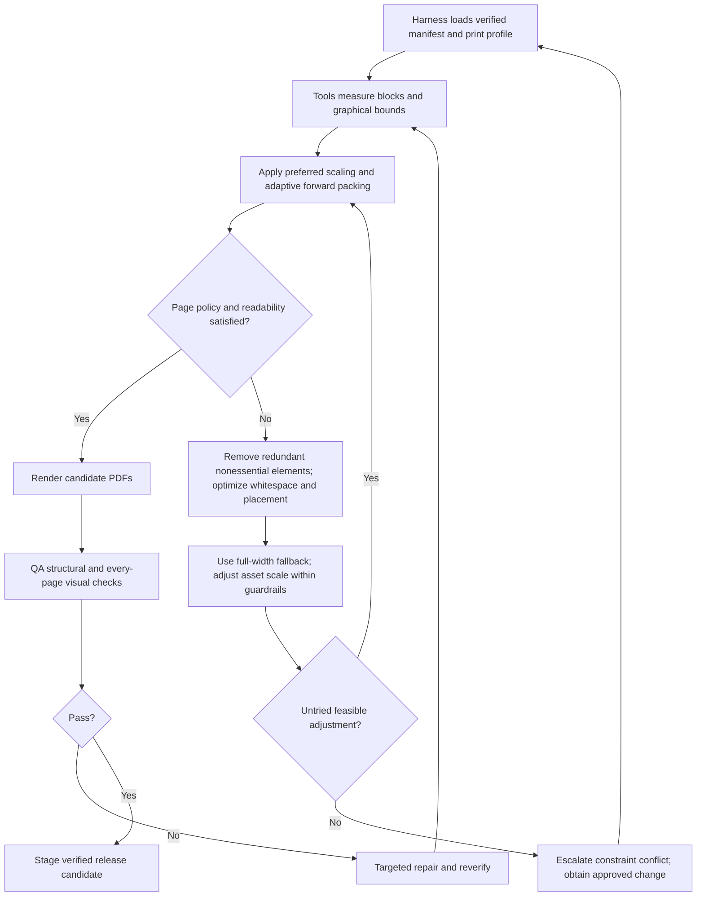

# Mock assessment configuration and presentation

## Independent dimensions

| Dimension | Values / meaning |
|---|---|
| Worksheet type | mock_assessment |
| Purpose | benchmark (readiness); diagnostic (skill gaps) |
| Academic length | full, mini, custom; relative to stated assessment scope |
| Source mode | source_based, ai_generated, hybrid |
| Coverage | comprehensive, multi_topic, single_topic |
| Academic profile | subject, grade/level, standards, reference exam, difficulty distribution |
| Conditions | time limit, question formats, scoring |
| Presentation | paper, pagination, layout, typography, asset scaling, fidelity, print efficiency |
| Governance | QA, exceptions, approvals, release |

A profile is a reusable preset combining dimensions, not a separate worksheet type. Benchmark and diagnostic can overlap in utility; primary purpose drives blueprint and scoring. Academic length is not physical page count.

## Assessment identifier and artifact naming

Assessment identity is independent of purpose, length, source, grade, subject, and instructional week.

- `BM` = Benchmark Assessment; `BM-02` = Benchmark Assessment #02 (sequence 02).
- The assessment identifier is a stable, human-readable key shared by the RunSpec, release manifest, verification reports, and published file names. Do not derive the identifier from the source exam's location or year (for example, `NY-2022`).
- Keep the type code and sequence as structured fields (`assessment_type_code: BM`, `assessment_sequence: 2`) and derive `assessment_id: BM-02`; retain source exam jurisdiction/year separately as provenance.
- Student document suffix: `Mock-Assessment`; teacher key suffix: `Answer-Key`.
- Canonical printable PDF name: `MTS-{Assessment-ID}-Grade-{Grade}-{Subject}-{Document-Type}.pdf`. Examples: `MTS-BM-02-Grade-4-Math-Mock-Assessment.pdf`, `MTS-BM-02-Grade-4-Math-Answer-Key.pdf`.
- In the flat PrintReady release, enforce unique names and exact student/key pairs by assessment ID, grade, and subject. Preserve source and scoring references in metadata, not the printable file name.

This is an approved naming/traceability contract, not a claim that the generator, JSON schema, or historical archive has been migrated. Implement and validate generator/manifest enforcement separately.

## Presentation requirements

Historical compact Math benchmark values (conversation-derived; verify against original implementation):

| Parameter | Value |
|---|---|
| Paper | US Letter, portrait |
| Layout | adaptive two-column, forward packing, full-width fallback |
| Student pagination | maximum 4, fewer acceptable |
| Key pagination | separate PDF, target 1 |
| Body / choices | approximately 9.2 / 9 pt |
| Diagram scale | preferred 75%, minimum 70%, 1 percentage point decrement |
| Diagram clearance | 6 pt minimum, measure labels and full bounds |
| Assets | preserve aspect ratio and original vector diagrams when available |
| Question blocks | intact; preserve sequential reading order and numbering |
| Whitespace | minimize unnecessary gaps; do not add work boxes just to fill space |
| QA | inspect every page, check print readability |

Pagination policies: maximum (ceiling), target (soft goal), exact (fixed), minimize (objective), flexible (proposed). Configure student and key independently. Scaling must be asset-specific; Math diagram policy does not automatically apply to ELA illustrations, tables, passages or typography. Preserve necessary response space and essential instructions. ELA uses complete passages, paragraph and poetry structure, associated questions, appropriate single/full-width or mixed layout, corrected line references and separate key. Exact ELA typography remains open.

Proposed reusable profiles: math_benchmark_compact (max 4), math_diagnostic_2page (exact 2), ela_benchmark_compact (configurable target), standard_test_print_efficient (minimize), source_fidelity (flexible), custom.

## Rendering optimization subprocess



Optimization priority: remove only nonessential redundancy, optimize whitespace, repack intact blocks in order, adapt columns/full width, then scale within limits. Reuse updated layout state during retries; bound attempts and log actual scales/page counts. Never silently remove content, distort figures, reduce readability below guardrails or exceed exact/maximum page constraints. Escalate conflicts; material changes require renewed approval. Target page count, preferred scale, whitespace and cost are optimization preferences; academic correctness, required source fidelity, no clipping/overlap, approved minima and atomic questions are hard guardrails.

## Illustrative RunSpec fragment (not a validated schema)

```yaml
run:
  worksheet_type: mock_assessment
  subject: math
  grade: 6
assessment:
  purpose: benchmark
  length: full
  coverage: comprehensive
  reference_exam: NY State Mathematics
  time_limit_minutes: null
source:
  mode: source_based
  year: 2025
  fidelity: strict
  selection: full_released_material
  official_key: required
blueprint:
  questions: 29
  multiple_choice: 19
  constructed_response: 10
  difficulty: preserve_source
  scoring: official_rubric
presentation:
  profile: math_benchmark_compact
  paper_size: US_Letter
  orientation: portrait
  student_pagination: {policy: maximum, pages: 4}
  key_pagination: {policy: target, pages: 1}
  layout: adaptive_two_column
  atomic_questions: true
  preserve_order: true
  allow_full_width: true
  optimize_whitespace: true
  diagram_scaling:
    preferred: 0.75
    minimum: 0.70
    step: 0.01
    minimum_clearance_pt: 6
    preserve_aspect_ratio: true
  constraint_violation: escalate
verification:
  independent_review: every_question
  source_fidelity: required
  coverage: required
  question_key_parity: required
  visual_qa: every_page
release:
  human_approval: required
  publish_to_print_ready: true
  archive_run: true
  capture_runtime: true
```

Full/comprehensive in example is relative to released material, not necessarily original administered exam. Time is unknown until approved. Blueprint should include standards/skill mapping, point weights, formats, difficulty and source selection rules. Canonical item manifest should carry stable item/source IDs, original and output numbering, passage/asset references, stem/options, answer/rubric, standards, provenance and QA status. Formal JSON schemas and validated presets are future work.
