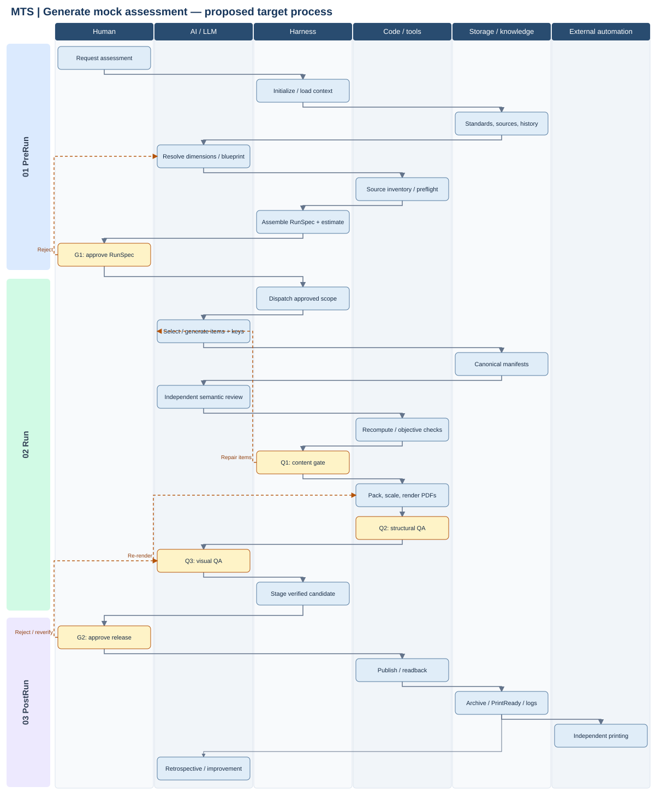

# Mock Assessment — revised process swimlane

[Open scalable SVG](end-to-end-swimlane.svg) · [Verification dashboard](../../outputs/dashboard.md) · [Full implemented workflow](../../workflows/generate-mock-assessment.md)

This replaces the earlier proposed diagram while retaining its six vertical responsibility lanes and three phase bands. It describes the verified initial milestone: NYSED 2024 Math Grades 4/5 and NYSED 2025 ELA Grade 6. Broader diagnostic/custom/generated/hybrid modes remain outside this implemented path.

| Lane | Responsibility |
|---|---|
| Human | Authorize educational scope, review the final student/key pair, explicitly approve exact production artifacts. The present benchmark scope already has autonomous implementation authorization. |
| AI / review agent | Independently solve and review answers, evaluate every alternative, verify source fidelity and every page, repair failures and record evidence. |
| Harness / orchestrator | Resume state, resolve the saved profile, validate the RunSpec, coordinate checks, evaluate matching development evidence and preserve checkpoints. |
| Code / PDF tools | Extract/render source-bound content, perform structural checks, calculate fingerprints, enforce release guards and coordinate publication/readback/recovery. |
| Storage / evidence | Original sources, user-designated goldens, RunSpecs, PDFs, completed review proofs, logs, PrintReady/archive and GitHub takeover state. |
| External automation | Existing independent printing after successful authorized publication. This implementation does not change or trigger that automation. |

## Reading the branches

- PreRun binds exact original sources, selected items, blueprint and approved page constraints, then saves RunSpec JSON/PDF. Invalid sources or unsupported scope stop with explicit next actions.
- Run always generates the pair and performs fresh structural checks. Academic/source/visual review may carry forward only when the source, canonical manifests, implementation, renderer version, all page pixels and evidence hashes match a trusted completed review. Otherwise an agent performs fresh reviews and repairs. The CLI does not silently infer semantic or visual correctness from structural success.
- The repair loop regenerates and rechecks changed content. Missing proof is never PASS. Completed run identities are preserved, while failures and retries are logged.
- PostRun verifies the 76-criterion development gate for the matching execution revision, saves the review package and presents the exact pair for human acceptance. These 76 criteria concern implementation acceptance; per-run checks and human release approval remain separate. Existing valid development proof may be evaluated without rerunning every development test for every unchanged benchmark.
- Changed or rejected final PDFs return to repair and renewed verification. A release receipt must identify the human approver and both exact approved PDF hashes.
- Publication validates all guards before writes. Neutral coordinators preserve other approved files, stage/read back new artifacts and recover failures. Drive predecessors retain their IDs in the archive. Persistent failure retains a journal or local approved backups with recovery instructions.
- Only verified published files are available to external printing. Reports/checkpoints and improvements remain available for the next run and Copilot takeover.

Blue boxes are activities, amber diamonds are decisions, green boxes are verified results, and amber return arrows identify repair, stop or recovery paths. The blue-outlined human approval diamond marks the current position: implementation verification passed, final human review/publication approval is pending. No production publication has occurred. Drive transport is tested with mocks; actual publication is not claimed.

## Regenerate the diagram

From the repository root, with requirements.txt installed:

    python scripts/render_mock_assessment_swimlane.py --export-dir <export-directory>

The script updates the canonical SVG here and exports a matching scalable SVG, single-page PDF and PNG for easy viewing. It follows the existing diagram's responsibility/phase design and changes no assessment generation code or acceptance evidence.
