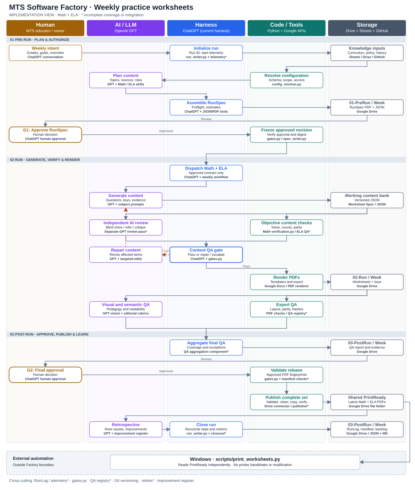

# Generate weekly practice worksheets

**Status:** Proposed target process, derived from the November 16 Math and ELA retrospective. This is a shared specification, not a claim that every component is deployed.

[Open scalable diagram](./end-to-end-swimlane.svg)

## Purpose and scope

Produce curriculum-aligned Math and ELA student worksheets and teacher keys, independently verify content, obtain human approval, publish the latest approved weekly set, and retain evidence for future improvements. See [Math specifications](../generate_math_worksheets/) and [ELA specifications](../generate_ela_worksheets/) for domain details. This shared specification does not replace them.

## Responsibility model

| Lane | Responsibilities |
|---|---|
| Human | Weekly intent, educational judgment, approval of RunSpec and final release, explicit exceptions |
| AI / LLM | Source selection, question design, reasoning, independent semantic review, repairs and retrospective |
| Harness | Context assembly, sequencing, tool invocation, gate enforcement, retries and execution state |
| Code / tools | Deterministic configuration checks, mathematical recomputation, schema and PDF validation, rendering and publishing |
| Storage / knowledge | Curriculum, configurations, source history, templates, versioned artifacts, evidence and operational history |
| External automation | Existing Windows print function reads the shared PrintReady folder independently |

Human decides; AI reasons; harness coordinates; code executes and verifies; storage remembers.

## Implementation mapping — level 1

The swimlane retains the target lifecycle and adds the current implementation technology and component labels. **Repo** means the named code is present at the inspected repository revision; **Observed** means the technology/artifact was used or recorded in the November 16 workflow; **Partial** means the target capability is not yet demonstrated end-to-end. An asterisk in the diagram denotes incomplete implementation, coverage or integration. Component labels are not a claim that the November 16 ChatGPT run invoked the repository scripts.

| Lane | Implementation |
|---|---|
| Human | MTS educator / release owner, interacting through ChatGPT |
| AI / LLM | OpenAI GPT; domain prompts, generation and editorial review |
| Harness | ChatGPT current execution environment; repository workflow and skills as portable instructions |
| Code / Tools | Python, Google Drive / Docs / Sheets APIs, PDF tooling |
| Storage / Knowledge | Google Drive, Google Sheets, GitHub; structured JSON, YAML and Markdown |
| External automation | Windows, `scripts/print_worksheets.py` |

| Activity | Implementation component | Evidence / maturity |
|---|---|---|
| Weekly intent | ChatGPT conversation | Observed |
| Initialize run | run_writer.py + telemetry* | Partial |
| Knowledge inputs | Sheets / Drive / GitHub | Observed |
| Resolve configuration | config_resolver.py | Repo |
| Plan content | GPT + Math / ELA skills | Observed |
| Assemble RunSpec | ChatGPT + JSON/PDF tools | Observed |
| 01-PreRun / Week | Google Drive | Observed |
| G1: Approve RunSpec | ChatGPT human approval | Observed |
| Freeze approved revision | gates.py / spec_writer.py | Partial |
| Dispatch Math + ELA | ChatGPT + weekly workflow | Partial |
| Generate content | GPT + subject prompts | Observed |
| Working content bank | Worksheet Spec / JSON | Observed |
| Independent AI review | Separate GPT review pass* | Partial |
| Objective content checks | Math verification.py / ELA QA* | Partial |
| Repair content | GPT + targeted edits | Observed |
| Content QA gate | ChatGPT + gates.py | Partial |
| Render PDFs | Google Docs / PDF renderer | Observed |
| 02-Run / Week | Google Drive | Observed |
| Visual and semantic QA | GPT vision + editorial rubrics | Partial |
| Export QA | PDF checks / QA registry* | Partial |
| Aggregate final QA | QA aggregation component* | Partial |
| 03-PostRun / Week | Google Drive | Observed |
| G2: Final approval | ChatGPT human approval | Observed |
| Validate release | gates.py + manifest checks* | Partial |
| Publish complete set | Drive connector / publisher* | Partial |
| Shared PrintReady | Google Drive flat folder | Observed |
| Retrospective | GPT + improvement register | Observed |
| Close run | run_writer.py + closeout* | Partial |
| 03-PostRun / Week | Google Drive / JSON + MD | Observed |

### Repository component references

- [Weekly workflow instructions](../../workflows/generate-weekly-worksheets.md) and [Math runbook](../../skills/math/weekly-worksheet-execution-runbook.md).
- [Configuration resolver](../../src/mts/infrastructure/configuration/config_resolver.py), [Math scope preparation](../../src/mts/subjects/math/weekly_workflow.py) and [weekly worksheet spec preparation](../../scripts/prepare_weekly_spec.py).
- [Revision-scoped gates](../../src/mts/workflow_management/gates.py), [spec writer](../../src/mts/worksheets/spec_writer.py), [run writer](../../src/mts/workflow_management/run_writer.py).
- [Math verification](../../src/mts/subjects/math/verification.py) and [validation](../../src/mts/subjects/math/validation.py).
- [Math Google Docs rendering](../../scripts/render_weekly_specs_to_drive.py) and [Google Docs adapter](../../src/mts/infrastructure/google_docs/google_docs_adapter.py).
- [Existing weekly publishing script](../../scripts/publish_weekly_artifacts.py) publishes validated pairs to a configured approved folder; it is not proof of combined latest-week PrintReady cleanup, approval validation or rollback. Shared publisher integration remains partial.
- [Independent Windows printer](../../scripts/print_worksheets.py).

The repository gate names are scope_review, question_review, verification_review, formatting_review and publish_approval. Diagram labels G1/G2 denote the two primary human boundaries, not literal repository gate numbers. Existing enabled intermediate gates remain applicable. ELA QA, renderer and source selection were observed in the separate ChatGPT/Drive workflow; their matching active repository modules were not located in the inspected Python tree. Do not substitute mock-assessment components for weekly worksheet components. Runtime telemetry, complete QA aggregation and closeout are still target capabilities.

## End-to-end lifecycle

| Phase | Sequence | Outputs |
|---|---|---|
| 01 PreRun | Initialize run; refresh curriculum, configurations, history; resolve weekly scope; select ELA sources and Math topics; preflight; estimate runtime; assemble RunSpec; obtain G1 approval | Approved RunSpec PDF + JSON |
| 02 Run | Dispatch approved Math/ELA scope; design structured content bank; independently solve or review; run objective checks; repair and reverify; render; inspect final exports | Student and teacher PDFs, content and export QA evidence |
| 03 PostRun | Aggregate QA; disclose exceptions; obtain G2 approval; verify exact approved artifacts; publish combined weekly batch; verify readback; reconcile logs; retrospective | QA report, evidence, release manifest, RunLog, improvement register, PrintReady copies |

G1 and G2 are the two primary human approval boundaries. Math's existing additional question-design and pedagogical checkpoints remain in force until explicitly consolidated. A rejected RunSpec returns to planning; a rejected release returns to the affected content or rendering stage, followed by re-verification and renewed approval. Blocking failures stop progression. A material RunSpec change requires renewed G1 approval; changed release artifacts require renewed G2 approval.

## Verification and correction

- Separate generation from review: Math independently recomputes answers; ELA independently predicts answers before seeing the proposed key and checks supporting text, ambiguity, distractors and source fidelity.
- Code checks exact counts, schemas, allocation, mathematical constraints, text/key parity, page size, pagination and fingerprints. AI editorial or visual judgment is not mislabeled as deterministic proof or human sign-off.
- Aggregate all applicable registry rules, distinguishing PASS, FAIL, NOT_VERIFIED and not applicable; record the method and evidence. Do not equate tests passing with complete educational certification.
- Repair affected content, rerun relevant checks and regressions, and escalate persistent failures. Explicit authorized exceptions remain NOT_VERIFIED, not PASS.

## Storage and release contract

Keep the phase-first weekly folder architecture separately for Math and ELA:

    outputs/
      01-PreRun/YYYY-MM-DD/   RunSpec PDF + JSON, preflight
      02-Run/YYYY-MM-DD/      Student and teacher PDFs only
      03-PostRun/YYYY-MM-DD/  QA, evidence, logs, manifests, improvements

The date is the instructional Monday. Working content banks and source evidence belong in designated working/evidence locations, not the worksheet-only Run folder.

Shared PrintReady is the configured flat delivery location, not the historical system of record. Validate both in-scope approved subject sets before cleaning previous-week print copies; preserve dated originals. A same-week correction preserves the other subject's current files. Serialize publishers; verify names, counts, sizes, IDs and hashes when available. Recover the prior verified set if publication fails. No report or log belongs in PrintReady.

The existing Windows printing function is independent and unchanged. No pause/resume handshake is required. Drive replacement is not atomic; schedule publication to finish before printing.

## Observability and continuous improvement

Capture run ID, phase, step, estimated duration, measured active elapsed time, human wait time, retries, status, input/output references and evidence from initialization onward. Emit Markdown and JSON RunLogs and reconcile their final state with the release manifest before closing. Missing measurements are unknown rather than zero.

Inner loop: generate → verify → evaluate → repair → reverify. Outer loop: retrospective → defect/root cause → policy, code, prompt or test improvement → regression validation → next RunSpec. Preserve historical evidence and durable issue IDs.

## Normal human interaction target

1. Initiate the week's run.
2. Approve the resolved RunSpec.
3. Approve the verified release with any explicitly authorized exceptions.

Additional human intervention occurs for domain-required checkpoints, material changes or unresolved educational risks. Full end-to-end automation, independent ELA editorial coverage and live runtime instrumentation remain hardening work.

## Diagram conventions

Columns represent responsible actors; bands represent lifecycle phases. Solid arrows show progression or artifact handoff; dashed amber arrows show content repair. The two human approval nodes also permit rejection and rework as described above. The external print function lies outside the Factory boundary. SVG uses editable vector text and does not depend on an AI model or diagram rendering service.
